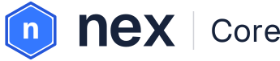
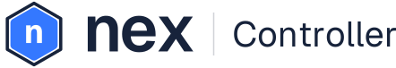
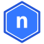

# Nex brand identity

Date: 2026-09-24  
Status: Hex identity approved by project owner on 2026-09-24, replacing the 2026-09-08 rounded-tile mark. The blue/platinum palette is unchanged; supporting colors extend it and do not replace the primary identity.

## Brief and product identity

Nex is the parent brand. **Nex Core** is the Debian-based virtualization host, using KVM/QEMU, libvirt, and a local agent. **Nex Controller** is the centralized management service, API, and web UI. Use one master symbol and wordmark, with Core and Controller as readable descriptors rather than separate brands. Write Nex, Nex Core, and Nex Controller in prose; a lowercase `nex` wordmark is an intentional visual treatment.

The project is in development. The [platform plan](../plans/2026-09-08-nex-platform.md) records current phase status; the [interface review](../plans/2026-09-08-feature-and-ux-review.md) defines future operator workflows. Brand approval changes neither acceptance gates nor product scope.

project owner clarified that the original blue, white, and grey identity stays primary. Colors from the later references are additions to the palette, not instructions to recolor the logo or replace the light brand board. Reference imagery supplies color inspiration only; do not copy competitor logos, typography, layouts, or wording.

## Approved logo treatment

The symbol is a white lowercase n on an electric-blue rounded hexagon, surrounded by a thin hexagonal ring. The n is Geist Bold. The `nex` wordmark is graphite Geist SemiBold with tightened spacing (−0.045 em), so the icon and wordmark share one letterform.

The ring color identifies the product; the rest of the symbol is identical:

| Product | Ring on light | Ring on dark |
|---|---|---|
| Nex Core | Action blue `#2456D9` | Mist blue `#7BA7D9` |
| Nex Controller | Graphite `#17233B` | Silver blue `#C6CEE4` |

| | Nex Core | Nex Controller |
|---|---|---|
| Lockup |  |  |
| Symbol |  |  |

Below 24 px the ring falls under one pixel, so favicons and other small marks use the shared ringless symbol (`nex-symbol-small.svg` and its 16/24/32 px PNG exports). The website represents the project rather than one product, so it pairs the ringless symbol with the wordmark at any size. Do not use a horseshoe/symmetric-arch n, split opposing chevrons, or an isolated x as the Nex emblem.

## Vector masters

`logo/` holds the production SVG masters. The wordmark, icon n, and Core/Controller descriptors (Geist Regular) are outlined, so no font is required. Geist is licensed under the SIL Open Font License 1.1.

| File | Use |
|---|---|
| `nex-core-lockup.svg`, `nex-controller-lockup.svg` (+ `-dark`) | Product entry points |
| `nex-core-symbol.svg`, `nex-controller-symbol.svg` (+ `-dark`) | Symbol where the product name is already clear, 24 px and up |
| `nex-symbol-small.svg`, `nex-symbol-16/24/32.png` | Favicons and marks under 24 px, shared by both products |
| `nex-symbol-mono.svg` | One-color mark in `currentColor` for print, installer, and console contexts |
| `nex-wordmark.svg` (+ `-dark`) | Wordmark alone |

## Primary palette

| Color | Hex | Role |
|---|---|---|
| Porcelain | `#F6F7FC` | Main light canvas |
| Platinum | `#E5E8F3` | Secondary surfaces |
| Silver blue | `#C6CEE4` | Decorative separation and supporting fills |
| Electric blue | `#3478FF` | Primary n tile and brand accents |
| Action blue | `#2456D9` | Buttons, links, selection emphasis |
| Graphite | `#17233B` | Wordmark, body text, headings |
| White | `#FFFFFF` | Reversed n icon and button text on action blue |

## Supporting palette

These extend the primary palette. They are available for secondary artwork and selected background treatments; their inclusion does not authorize changing the primary logo colors or default light presentation.

| Color | Hex | Role |
|---|---|---|
| Smoky plum | `#393149` | Optional dark background/gradient |
| Midnight navy | `#202B3B` | Optional dark background/gradient |
| Deep teal | `#08282E` | Optional dark background/gradient |
| Silver | `#AAB5C8` | Supporting text on dark backgrounds |
| Mist blue | `#7BA7D9` | Supporting accents on dark backgrounds |
| Lime | `#B5D43B` | Optional small decorative accent; never replaces the blue n icon |

Optional background treatment, used locally rather than across the primary brand board:

```css
background: #202B3B;
background: linear-gradient(45deg, #393149 0%, #202B3B 52%, #08282E 100%);
color: #E5E8F3;
```

Keep the original light presentation dominant: porcelain/platinum surfaces, graphite text, and blue emphasis. Keep logos solid and reproducible in one color. Avoid glow, metallic text, and heavy shadows. Supporting colors do not mandate a dark application theme. Core and Controller share the same palette; product names and the symbol's ring color identify them.

## Contrast and status

Calculated contrast ratios: graphite on porcelain **14.65:1**, graphite on platinum **12.81:1**, white on action blue **6.16:1**, and action blue on porcelain **5.76:1**. White on electric blue is **3.98:1**: use action blue for normal-size white button text. Pale silver is decorative, not an essential control boundary.

Graphite on lime is **9.29:1**; white on lime is only **1.69:1**, and lime on porcelain is **1.58:1**. Pair lime with graphite for readable detail. Use platinum/silver text on dark supporting backgrounds; mist blue is not body text on platinum. Validate actual controls, text, and focus states during UI work.

Status colors remain separate functional tokens. Use explicit labels and icons for success, failure, warning, offline, and stale state. Brand colors and the n icon do not indicate health or completed work.

## Type and usage

Use the existing proposal's system sans stack for product UI: `system-ui, -apple-system, BlinkMacSystemFont, "Segoe UI", sans-serif`. The wordmark is outlined Geist artwork; it does not establish a UI font dependency. Use sentence case, readable medium weights, and tabular numerals for aligned metrics where supported.

Use the full Nex Core or Nex Controller lockup at product entry points. Use the standalone Nex symbol only where the product name is already clear. Keep clear space of half the symbol height (outer ring included) on every side. Use `logo/nex-symbol-mono.svg` for one-color small marks, print, and installer/console contexts. Text-only Nex Core remains suitable for a terminal.

## Production asset status

Vector masters, product lockups, a one-color mark, and 16/24/32 px icon exports exist in `logo/`. The Controller and local host web UI, the website, and the installer/boot splash use copies of or renders from these masters; the previous raster board was retired on 2026-09-24. Continue checking these colors against actual Controller screens when UI styles change.
