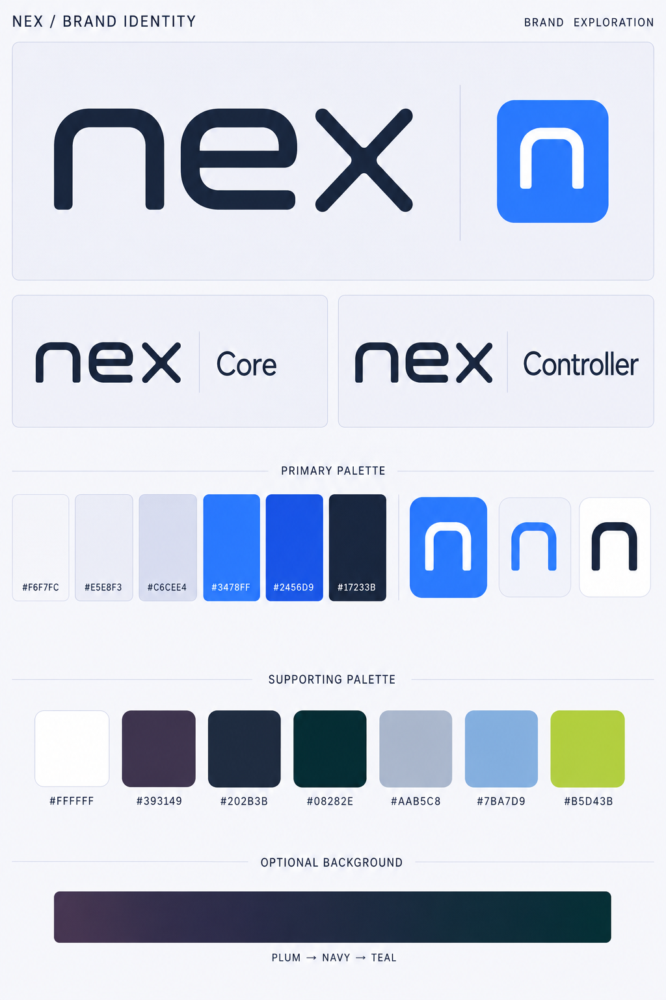

# Nex brand identity

Date: 2026-09-08  
Status: Original blue/platinum Relay revision 2 identity approved by Matt on 2026-09-08. Additional reference colors extend the palette; they do not replace the primary identity.

## Brief and product identity

Nex is the parent brand. **Nex Core** is the Debian-based virtualization host, using KVM/QEMU, libvirt, and a local agent. **Nex Controller** is the centralized management service, API, and web UI. Use one master symbol and wordmark, with Core and Controller as readable descriptors rather than separate brands. Write Nex, Nex Core, and Nex Controller in prose; a lowercase `nex` wordmark is an intentional visual treatment.

The project is in development. The [platform plan](../plans/2026-09-08-nex-platform.md) starts at Phase 0; the [interface review](../plans/2026-09-08-feature-and-ux-review.md) defines future operator workflows. Brand approval changes neither acceptance gates nor product scope.

Matt clarified that the original blue, white, and grey identity stays primary. Colors from the later references are additions to the palette, not instructions to recolor the logo or replace the light brand board. Reference imagery supplies color inspiration only; do not copy competitor logos, typography, layouts, or wording.

## Approved logo treatment

Use the original rounded graphite `nex` wordmark with a continuous crossed x, and a white lowercase n on an electric-blue tile. Nex Core and Nex Controller use graphite wordmarks with their product descriptors on porcelain/platinum backgrounds. Preserve the original logo shapes and blue icon.

Do not use split opposing chevrons or an isolated x as the Nex emblem. Keep one current board in this folder.



The board is a raster design reference, not a production vector master. Written color values below are authoritative if rendered swatches differ.

## Primary palette

| Color | Hex | Role |
|---|---|---|
| Porcelain | `#F6F7FC` | Main light canvas |
| Platinum | `#E5E8F3` | Secondary surfaces |
| Silver blue | `#C6CEE4` | Decorative separation and supporting fills |
| Electric blue | `#3478FF` | Primary n tile and brand accents |
| Action blue | `#2456D9` | Buttons, links, selection emphasis |
| Graphite | `#17233B` | Wordmark, body text, headings |
| White | `#FFFFFF` | Reversed n icon and button text on action blue |

## Supporting palette

These extend the primary palette. They are available for secondary artwork and selected background treatments; their inclusion does not authorize changing the primary logo colors or default light presentation.

| Color | Hex | Role |
|---|---|---|
| Smoky plum | `#393149` | Optional dark background/gradient |
| Midnight navy | `#202B3B` | Optional dark background/gradient |
| Deep teal | `#08282E` | Optional dark background/gradient |
| Silver | `#AAB5C8` | Supporting text on dark backgrounds |
| Mist blue | `#7BA7D9` | Supporting accents on dark backgrounds |
| Lime | `#B5D43B` | Optional small decorative accent; never replaces the blue n icon |

Optional background treatment, used locally rather than across the primary brand board:

```css
background: #202B3B;
background: linear-gradient(45deg, #393149 0%, #202B3B 52%, #08282E 100%);
color: #E5E8F3;
```

Keep the original light presentation dominant: porcelain/platinum surfaces, graphite text, and blue emphasis. Keep logos solid and reproducible in one color. Avoid glow, metallic text, and heavy shadows. Supporting colors do not mandate a dark application theme. Core and Controller share the same palette; product names identify them.

## Contrast and status

Calculated contrast ratios: graphite on porcelain **14.65:1**, graphite on platinum **12.81:1**, white on action blue **6.16:1**, and action blue on porcelain **5.76:1**. White on electric blue is **3.98:1**: use action blue for normal-size white button text. Pale silver is decorative, not an essential control boundary.

Graphite on lime is **9.29:1**; white on lime is only **1.69:1**, and lime on porcelain is **1.58:1**. Pair lime with graphite for readable detail. Use platinum/silver text on dark supporting backgrounds; mist blue is not body text on platinum. Validate actual controls, text, and focus states during UI work.

Status colors remain separate functional tokens. Use explicit labels and icons for success, failure, warning, offline, and stale state. Brand colors and the n icon do not indicate health or completed work.

## Type and usage

Use the existing proposal's system sans stack for product UI: `system-ui, -apple-system, BlinkMacSystemFont, "Segoe UI", sans-serif`. The approved wordmark uses custom lettering; it does not establish a font dependency. Use sentence case, readable medium weights, and tabular numerals for aligned metrics where supported.

Use the full Nex Core or Nex Controller lockup at product entry points. Use the standalone Nex symbol only where the product name is already clear. A proposed starting clear space is half the symbol height on every side; confirm after the chosen mark is drawn as a vector. Keep a one-color version for small marks, print, and installer/console contexts. Text-only Nex Core remains suitable for a terminal.

## Production asset status

The original blue/platinum identity is approved; supporting colors expand its available palette. Vector masters, separate product lockups, and 16/24/32-pixel icon exports remain to be produced and checked. Review the colors in an actual controller screen when UI work begins. The custom installer header now renders the approved Nex Core lockup directly from this
board using native image cropping and scaling; it does not approximate the mark with a font.
This is reuse of the approved raster artwork, not a completed production vector master.
See [installer logo verification](../qa/iso/2026-09-08-installer-logo.md).
