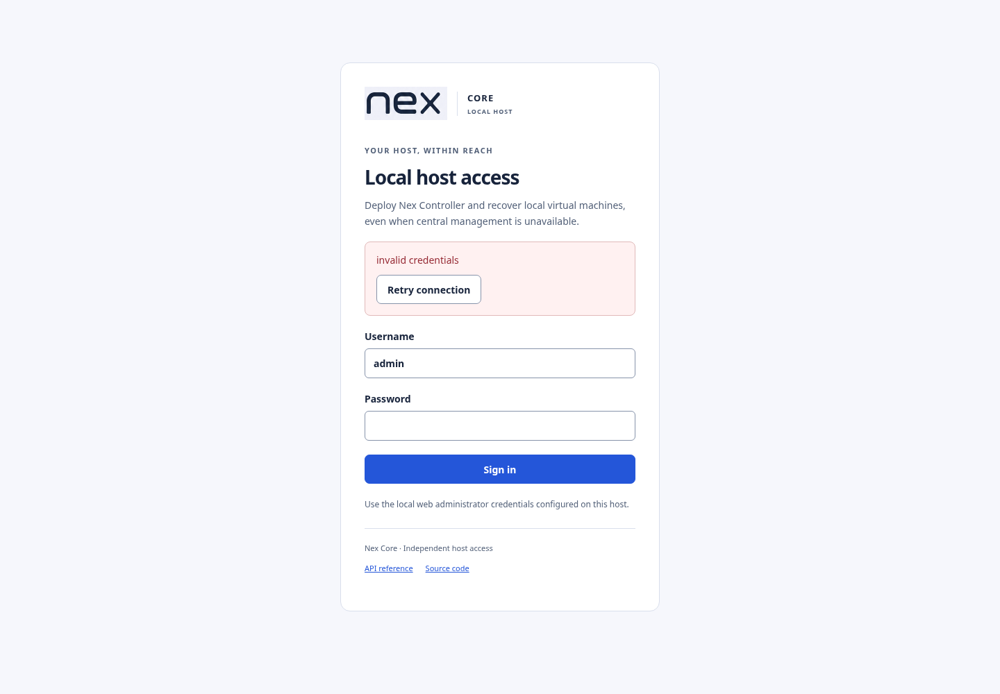
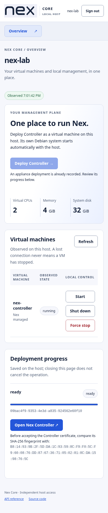
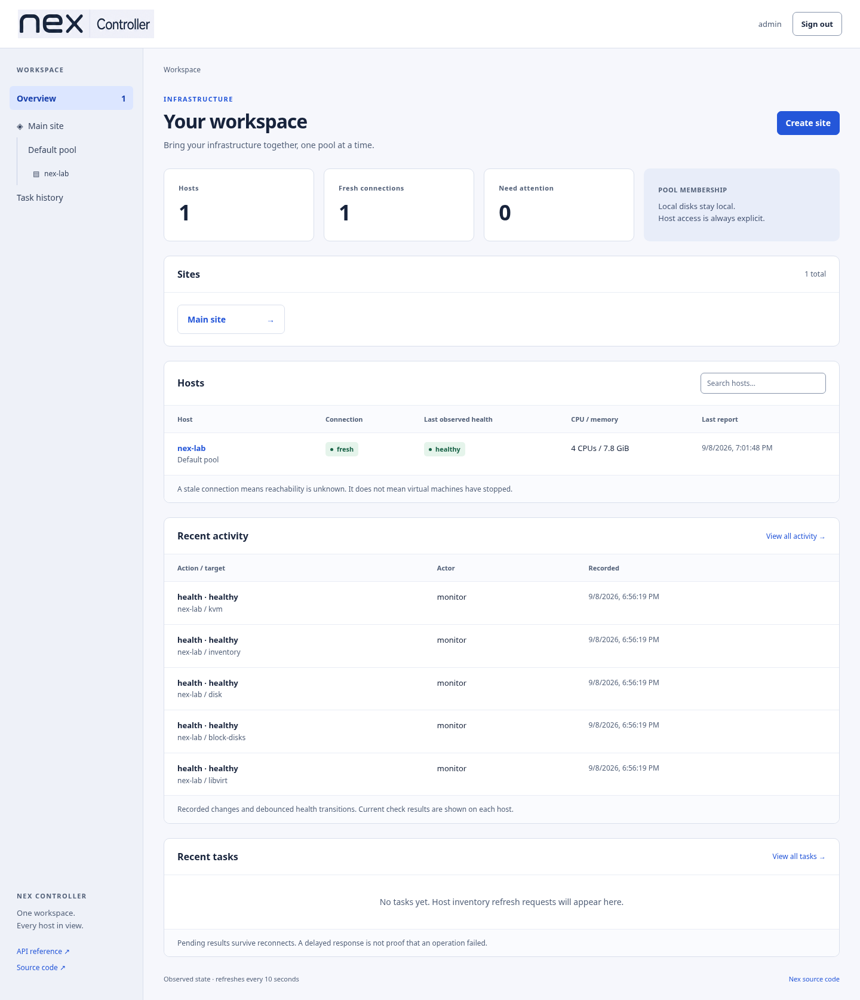
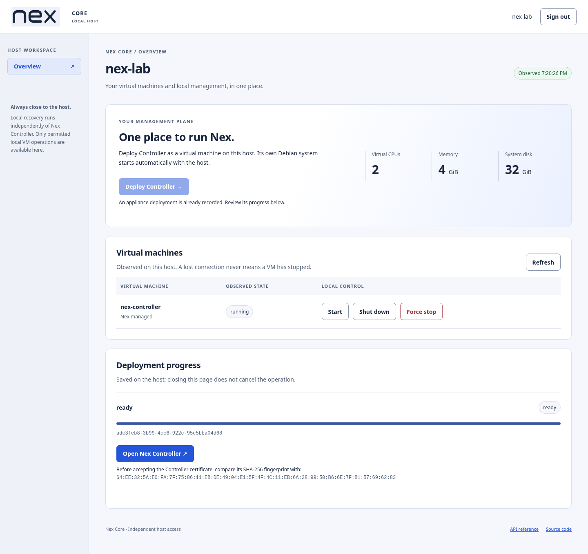
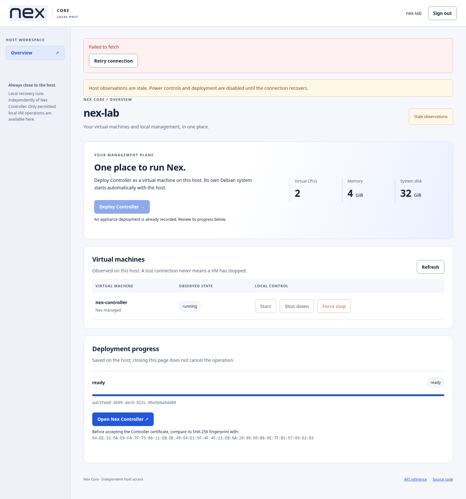
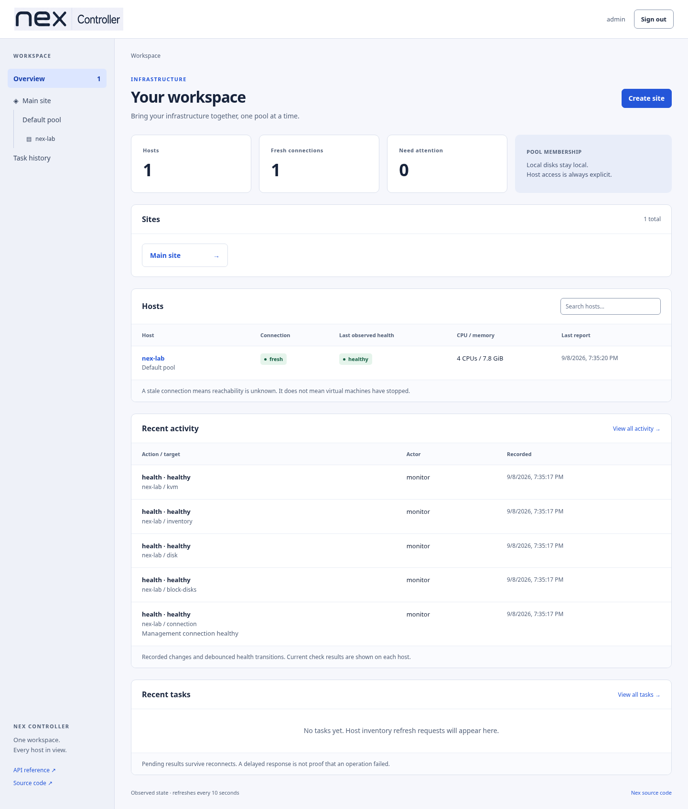

# Controller appliance disposable KVM verification

Date: 2026-09-08. Status: clean package deployment, restart/outage checks and separate-host restore with existing-agent reconnect passed. Replacement-host autostart and post-reboot login/reconnect checks passed.

## Environment and isolation

The workstation runs QEMU 11.1.1 with accessible KVM and nested Intel virtualization.
A new private lab directory contains a reflink/sparse copy of the earlier disposable
Nex Core wizard disk. The original disk was never booted or modified during this test.
The copied host runs Nex Core 0.1.0-alpha1 (Debian 13), four virtual CPUs and 8 GiB RAM.
No physical disks or workstation network settings were changed. Existing unrelated
Docker services were untouched.

Preparation mounted only the copied regular-file disk's first partition to install a
new test-only SSH public key and prohibit password SSH login. The mount was removed
before QEMU started. QEMU uses user networking with loopback-only port forwards;
its two NIC MACs match the copied host's installed interface identities.

A newly created 80 GiB regular-file disk was hotplugged into this disposable host.
Before formatting, the guest check required both its exact byte size and its observed
virtio serial, `NEX-APPLIANCE-QA-ONL` (QEMU truncates the requested longer serial).
It was formatted as ext4 and mounted at `/var/lib/nex/appliances`; 75 GiB was available.
The guest's libvirt default NAT network supplies the existing `virbr0` bridge,
`192.168.122.1/24`. This bridge is inside the disposable VM, not the workstation.
`genisoimage` was installed only inside that guest.

## Actual preparation results

- `systemctl is-system-running`: `running`.
- `/dev/kvm` exists inside the guest; nested appliance boot is not yet established.
- `virsh -c qemu:///system list --all`: successful, no domains before deployment.
- `qemu-img` and `genisoimage` are installed inside the guest.
- New SSH key authentication through a loopback QEMU forward succeeded.
- Native libvirt network start/autostart succeeded; the bridge has the expected address.

Local preparation artifacts include QEMU command JSON, process ID, serial output,
SSH known-host identity, host baseline and storage/network command output in the
private ignored lab directory. Private SSH keys are not publication evidence.

## Evidence boundaries

Preparation and earlier development results below are distinct from the final clean
package run. Physical hardware, release-distribution clearance and hosted CI were not
verified by this lab. Separate-host restoration is recorded only after its actual checks.

## Host-local service and browser checks

Built the current `nex-core-local` Go executable and served the compiled local web
assets through actual HTTPS inside the disposable host under systemd. This is a
development direct-binary setup, not installation of the final Debian package.

Ran the installed Playwright Chromium browser using:

```sh
.cache/phase1-qa-venv/bin/python tests/integration/appliance-lab.py \
  --lab-dir .cache/nex-appliance-lab.<redacted> --evidence docs/qa/appliance
```

The real application rejected incorrect credentials; keyboard submission signed in
successfully. Anonymous VM inventory, missing Origin, missing CSRF token, and invalid
deployment input were rejected with the expected 401, 403, 403 and 400 responses.
The initial empty VM/deployment state showed the actual host identity and the specific
`appliance manifest unavailable` blocker; deployment remained disabled while the
builder was still preparing its artifact. Later reruns replaced the overview captures
with the current observed state; that initial blocker result is historical. No HTTP routes or virtualization were mocked.
The browser reported no JavaScript errors. Inspected the 1440-pixel desktop and
390-pixel narrow overview captures; controls, empty state and blocker were readable,
with no horizontal document overflow. This does not yet verify the deployment wizard
or successful appliance creation.





The executable's matching development source snapshot SHA256 was
`004d39cf2b7dce24dc850a286361a27914c7a4b9bc99c7a2bc81315ff6f40944`.
Subsequent implementation updates require refreshed binary/source evidence before
final acceptance. Structured development results are in [results.json](results.json)
and [host-preflight.json](host-preflight.json).

## Development appliance run and reproduced failures

The first real image was the earlier `appliance-lab2` artifact. Its source digest was
`e71508e7979543e9024b92947373c936cc91a509acff2bbf058578ace7293753`.
This run found issues that simulated commands had not established:

1. QEMU could not create the explicit VNC socket under the root-owned disk directory.
   The API retained one stopped VM and reported `needs_attention` at 80% rather than
   creating another disk. The fixed engine delegates the private socket location to
   libvirt. Recovery of this already-defined development VM required manually removing
   only its two explicit socket attributes, then using the local GUI's confirmed Start
   and Retry actions. [Original failure](initial-start-failure.json),
   [libvirt output](initial-start-libvirt.txt), [failure capture](initial-start-failure.png).
2. Debian's `cloud-final.service` is ordered after `multi-user.target`. Enabling
   `nex-appliance-init` under that target while ordering it after cloud-final caused an
   ordering cycle; systemd explicitly deleted the init job. The builder moved its
   install target to `cloud-init.target`. This development run manually started init
   after cloud-init finished to continue investigation.
3. The copied public web directory was root-owned mode 0700. Controller APIs worked,
   but the actual browser/readiness GET `/` returned 403. The builder corrected public
   asset permissions. This development guest needed a manual public-tree permission
   correction and init restart. [Observed original permissions](initial-public-permissions.txt).
   The initial backend also reported readiness before this UI/cleanup failure was
   resolved; readiness checks were strengthened for the final artifact.
4. The host recovery helper's actual `virsh` stdin mode echoed a prompt and command,
   breaking XML parsing. Long input also produced truncated readline echo. The helper
   now parses the documented command results without placing archive material in argv;
   a subsequent actual export succeeded.

After these explicit development corrections, actual browser login showed one Site,
Pool, enrolled host and adopted original VM UUID. A Controller service outage retained
local HTTPS access and a running VM. Typed wrong-host shutdown confirmation was
rejected; confirmed graceful shutdown and cold start restored the same guest, static
network and initialized Controller without its bootstrap seed. A host-local systemd
service restart retained the same running VM and one ready deployment.

The actual nested guest reported two vCPUs, 3922 MiB total RAM, a 32 GiB root filesystem
with 30 GiB available, and `192.168.122.10/24` on `nex0`; these are guest observations,
not only requested settings. The browser reached the nested Controller through a
loopback SSH forward. This verifies its real HTTPS application, not physical-LAN routing.



The host recovery helper then stopped Controller and exported its identity/state through
QEMU guest-agent commands without injecting guest SSH access. The private archive was
copied off the host with mode 0600 and all six recorded file hashes were checked. The
archive is not committed; [non-secret export evidence](export-verification.json) records
its digest. This lab2 archive is not valid evidence of a restore to the different final
source version. Its guest and outer host were then shut down, preserving their disks.

These are development recovery results, **not a seamless clean deployment claim**.
A separate pristine package/image run and same-version replacement restore follow below
when executed; until then those final acceptance items remain open.

## Clean final package deployment

A third fresh outer Nex Core host used only its own copied disk, a newly formatted
80 GiB storage file and an internal libvirt bridge. The second host's failed package
attempt was preserved and stopped: package service `UMask=0077` exposed a further
engine defect where requested directory mode 0711 became 0700. The engine now applies
0711 explicitly after exclusive creation; credentials and disk/seed permissions were
not broadened. [Retained package failure](package-umask/libvirt-failure.txt).

The pristine third host installed `nex-core-local_0.1.0+lab6.1_amd64.deb` through APT,
then used the shipped `core-local-setup configure` command with management address
`10.0.2.15`, `/var/lib/nex/appliances` and existing `virbr0`. The native service retained
`UMask=0077`. No executable, guest file, XML or permission fix was injected into this run.

| Artifact | SHA256 |
|---|---|
| Host package 0.1.0+lab6.1 | `679197247d98b5130fbdedcf415e0e24ce4235abf1150b3ccc906b7bf0a4304a` |
| Installed host source | `b4228bcd0aa3e5f8143e55ec9a8d9a5a7e0deed09c23897ca64c28387ef6a67c` |
| Signed appliance image 6 | `1238b82eb905c40c11b474b8bae7837f52c631296dfcc52d1d70bd57088b7a55` |
| Appliance Controller source | `d4fc22c13c6f160f03f59fe65892b10182045de5c6ba2b6a7c3d5dc3ce8221f3` |

[Installed artifact checks](final/installed-artifacts.txt) and
[package hash](final/artifact.json) distinguish host and guest corresponding source.

The actual browser selected storage/bridge and supplied static address, DNS, resources
and a private administrator password, reviewed the request and pressed Create VM &
install Controller. Deployment progressed automatically through 0%, 10%, 92%, 98% and
100% to `ready`. It created one VM UUID, `private-id-033`.
[Original clean progress observations](final/clean-first-deployment.json) are retained
separately from reruns that observed the already-ready operation.

Executed:

```sh
.cache/phase1-qa-venv/bin/python tests/integration/appliance-lab.py \
  --lab-dir .cache/nex-appliance-lab.<redacted> \
  --evidence docs/qa/appliance/final --deploy --packaged
```

The runnable check passed actual invalid login, keyboard login, unauthorized/Origin/CSRF
and invalid-input rejection, signed-manifest tamper rejection, page refresh with one
UUID, Controller browser login, and exactly one Site/Pool/enrolled host/adopted original
VM. Before the first reboot it checked removal of bootstrap password/configuration,
`/var/lib/cloud` user data and `/run/cloud-init/instance-data-sensitive.json`.

It stopped the Controller service while observing its VM still running and local HTTPS
remaining available, then exercised typed shutdown confirmation (wrong target rejected),
graceful shutdown and cold start. The guest returned with persistent static networking,
no seed or bootstrap credentials, and the same Controller identity. Actual root filesystem
size was 33,603,391,488 bytes, two vCPUs and 4,016,552 kB MemTotal;
[guest output](final/controller-cold-start.txt) includes the measured available space.

Stopping local management produced a real failed-fetch/stale-observation display with
power controls disabled while Controller HTTPS remained available. Restarting the native
service, waiting for actual HTTPS readiness and signing in retained one running VM and
one operation. An early harness reload raced Type=simple startup; the harness now polls
`/healthz` before reloading. That timing correction required no application change.
[Complete actual check results](final/results.json).

Inspected final Controller, ready deployment, desktop/narrow local UI and stale-controls
captures. Controls, identity, progress and failure states were readable; no horizontal
page overflow occurred at 390 pixels, and no uncaught JavaScript errors were reported.





The shipped host recovery helper exported the final Controller to a new private archive,
then an off-host copy was checked against all six manifest hashes. Its source hash exactly
matches appliance image 6. Original VM autostart was disabled and `shut off` was observed
before any replacement preparation. [Export and initial exclusion evidence](final/export.json).
The secret archive remains only in the private ignored lab directory, never in these reports.

## Separate-host recovery with the shipped package

A fourth, separately copied disposable host received the same package 6.1 and signed
image 6. The original Controller UUID `private-id-033`
remained shut off with autostart disabled throughout recovery. The original host stayed
on solely to prove its already enrolled agent could reconnect. No original VM or
ownership journal was fabricated or relocated.

With local management stopped, the shipped `core-local-setup prepare-recovery` command with
`--request-file /root/replacement.json` created replacement UUID
`private-id-027` and returned
[`recovery_prepared`](final/recovery-prepared.json). This path initialized an empty
Controller without creating another site, pool or host enrollment. The off-host archive
was copied onto that selected replacement host, then the shipped helper ran:

```sh
/usr/lib/nex/host-recovery restore \
  --vm private-id-027 \
  --original-vm private-id-033 \
  --original-external --original-stopped-and-excluded \
  --replace-empty-controller --archive /root/controller-final.tar.gz \
  --state-dir /var/lib/nex/core-local/vmhost \
  --storage-dir /var/lib/nex/appliances
```

The helper completed and left the Controller service stopped, as documented
([actual output](final/restore.txt)). QEMU guest agent then started that service; no
appliance SSH access, manual database modification or guest-code patch was used.
The temporary preparation request was removed and local management restarted.

To represent the shared management LAN using these isolated NAT lab hosts, a new
QEMU socket Ethernet link joined only their guest bridges. The original host's bridge
received unique MAC `52:54:00:99:01:01` and address `192.168.122.2/24`; the replacement
kept gateway `192.168.122.1/24` and restored Controller `192.168.122.10`. Initially the
copied bridges' identical IDs caused STP to block the link; the unique MAC corrected
this lab-copy issue. An explicitly lab-only unit reattaches the replacement's new NIC
after reboot. These network adaptations are test topology, not installer behavior or
proof of physical LAN compatibility. Browser access used a loopback SSH forward.

Actual browser sign-in accepted the original administrator password. Site, pool, host
and original VM IDs all matched the original inventory. The restored certificate's
SHA-256 was `64ee325ae0fa7f758611ebde4904e15f4f4c11eb6a289950b66e7fb157696283`,
identical to the original deployment pin, and `/source` downloaded the exact image 6
source archive. The already enrolled original agent reconnected with its existing
identity and reported the original VM **shut off**, with a fresh observation.
[Restored inventory](final/restored-inventory.json), [check results](final/recovery-results.json).



This is a manual, explicit recovery workflow. The restored database retains the original
Controller VM's placement on the original host; the replacement host is not automatically
enrolled and the replacement VM is not automatically adopted. Recovery proves preserved
management identity and reconnect, not automatic inventory relocation, cross-version
restore, shared-storage recovery, HA or a production fencing mechanism.

The replacement outer host was rebooted while the original VM stayed excluded. Libvirt
automatically started the restored VM and Nex local management started natively. On the
first attempt, the lab-only link unit ran before libvirt created its bridge; its failure
was `virbr0: Device does not exist`. Adding a bounded bridge-readiness wait to that
fixture and rebooting again produced active local management, active lab networking and
an automatically running restored VM. [Labeled reboot and exclusion evidence](final/replacement-host-reboot.txt).

After the second reboot, the browser repeated original-password sign-in, exact TLS and
source hash checks, preserved-ID comparisons and the fresh original-agent stopped-VM
assertion successfully. The restored Controller was then shut down gracefully before
powering off the two remaining disposable outer hosts; disks and private recovery
archives are preserved for review.
[Final process checks](final/lab-shutdown.json) confirm all four disposable outer QEMU
processes exited and every copied host disk remains preserved.
