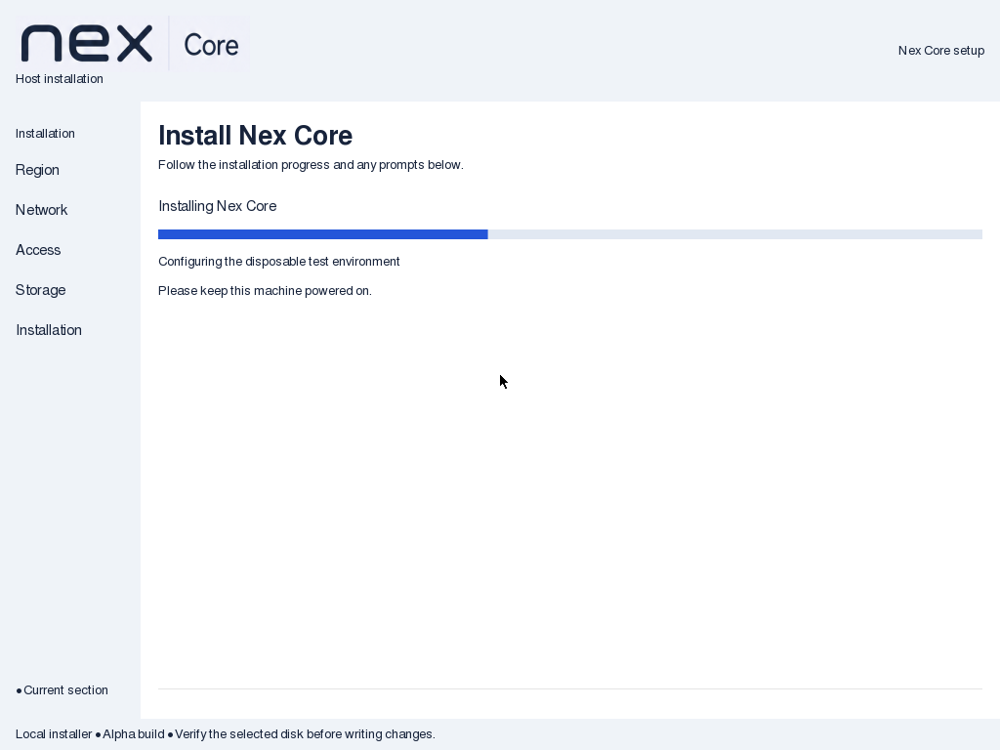
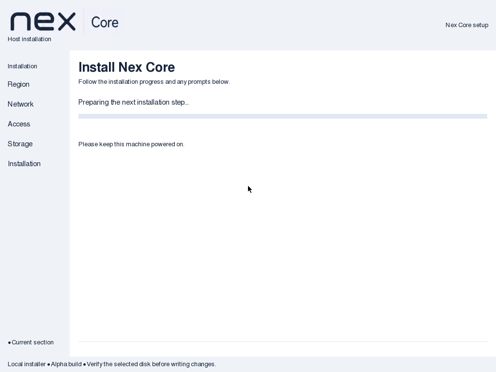
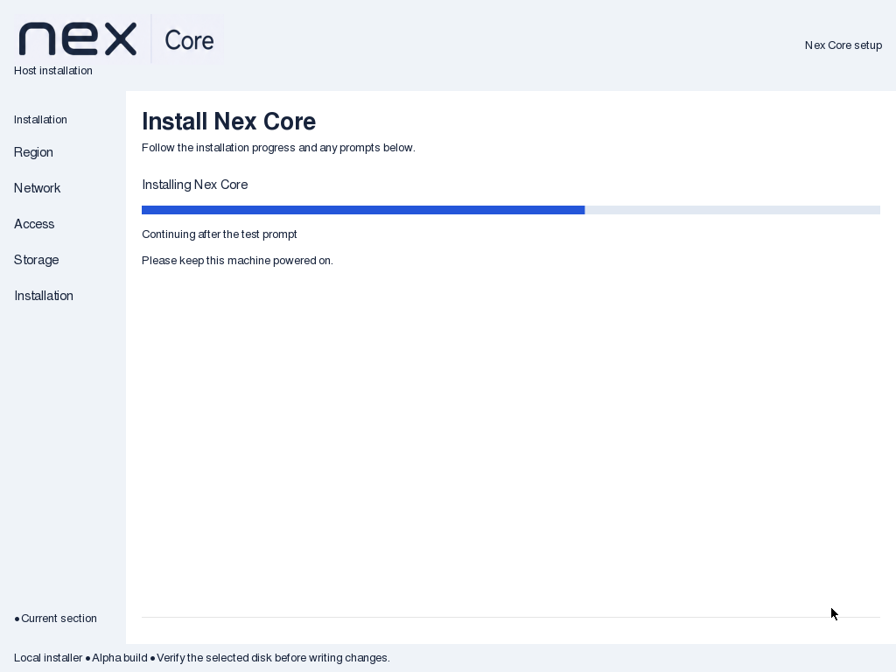
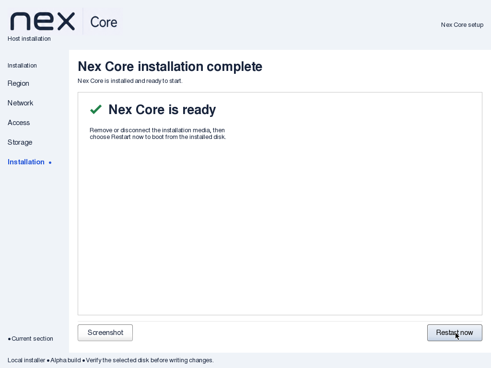

# Continuous Nex progress verification

Date: 2026-09-08. Nex Core 0.1.0-alpha1.

API impact: none; local cdebconf GTK rendering only. Guide impact: updated.

## Results

ISO SHA256: `e252ca7fe1402d6b3e6d9ce61e98c969e7ca1f29f61addc4ab9ca12a06bf5135`.
Build, checksum, retained frontend source comparison and complete-initrd checks passed.
Actual log-reader/phase, generated-preseed and installer mode/syntax checks passed.

The old ISO passed the earlier nonempty-panel check but failed the new native flat-track
and geometry assertion. Its active screen used a different stock bar and spacing from
the waiting screen. That baseline is preserved separately from the updated evidence.

The final fully automated diskless QEMU/KVM protocol walkthrough passed at 1024×768.
The flat track occupied the same rectangle (162,235)–(1006,245) in active, gap, resumed
and final-gap captures. Actual component values produced 40% and 60% fill; gaps cleared
the fill without replacing the track. The heading and power reminder stayed in place.
The stock beveled bar and italic status entry were absent.

The test also opened and scrolled the failure log, returned to the unchanged error,
acknowledged it, and resumed progress. A second error while progress was active returned
to the same 60% panel. The custom completion remained blocking until Restart now was
acknowledged. No GTK critical messages were found. The guest was stopped afterward.

An exploratory run needed test-only corrections: click the native Continue button
instead of assuming an Alt+C mnemonic, and exclude the moved pointer from the fixed
reminder comparison. The final run completed without manual input or product changes.

Documentation structure and whitespace checks passed; independent source and native
visual review found no blocking issues.

## Limits

Controlled protocol commands simulate component boundaries; they do not establish
physical display behavior or a complete installation. Backend actions are unchanged.
This slice does not repeat a full installation/reboot; prior completion evidence is
recorded separately in [progress/completion QA](2026-09-08-installer-progress.md).
Cancellation remains on its native path and was source-reviewed, not activated in
this walkthrough. No production disks or live infrastructure were used. Hosted CI
was not run; both installer workflows already invoke the extended regression.
