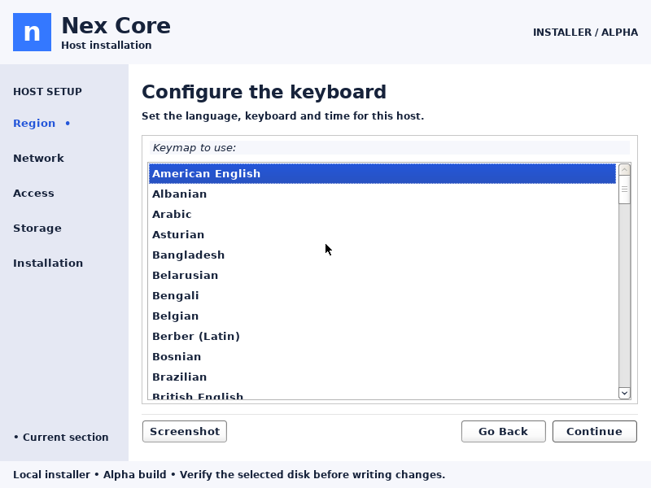
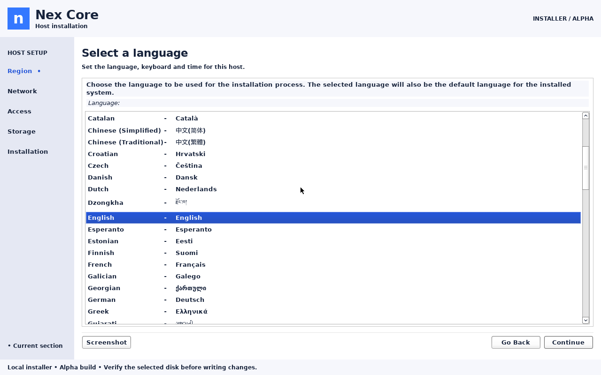
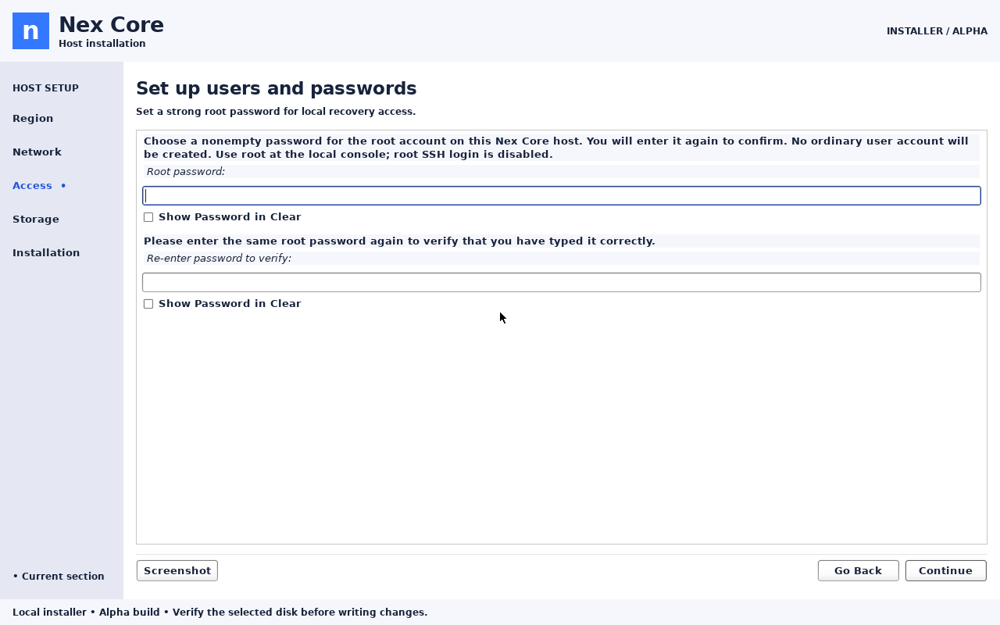
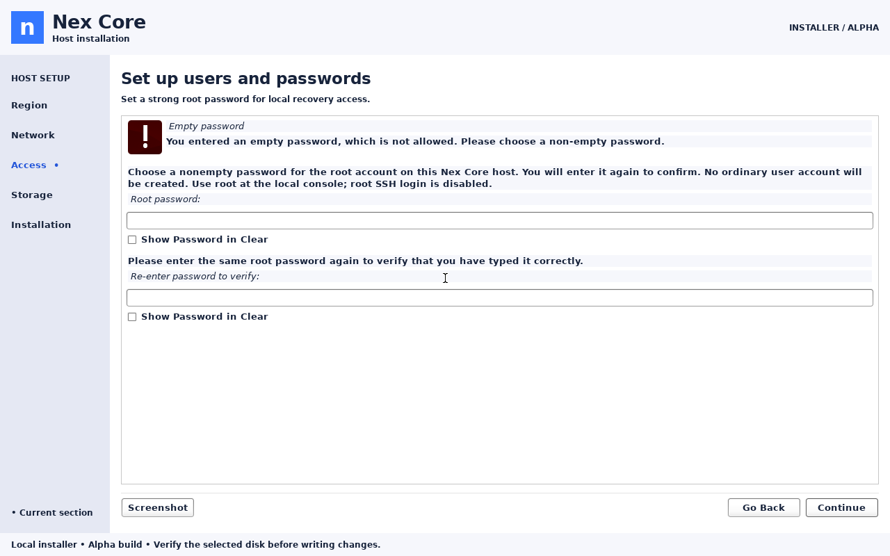
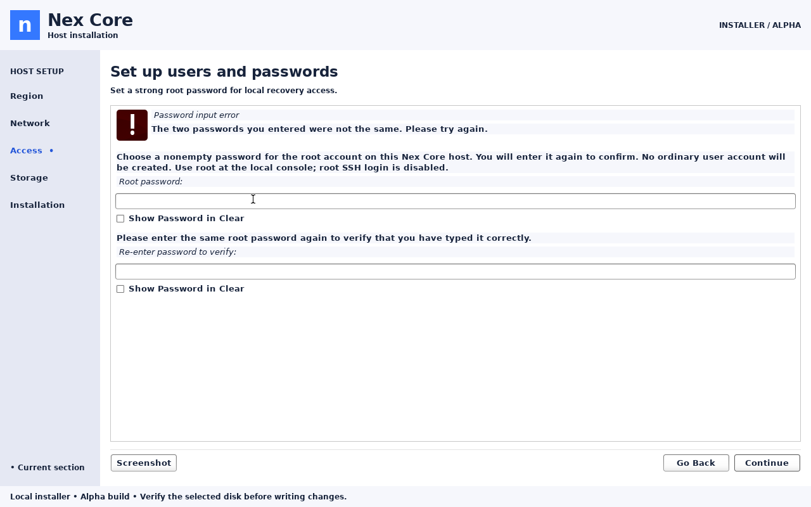
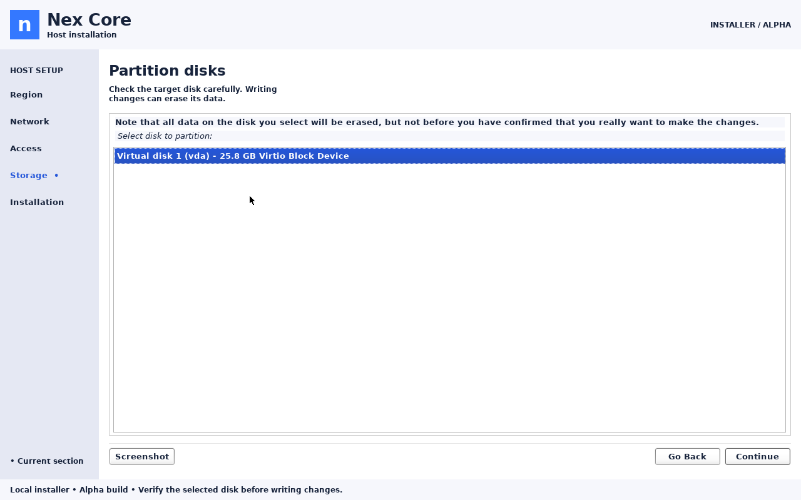
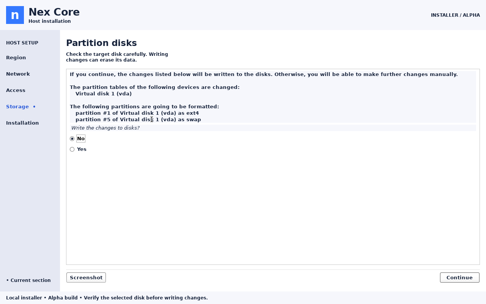
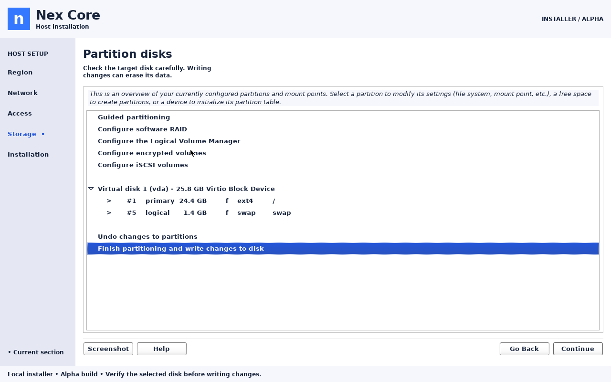
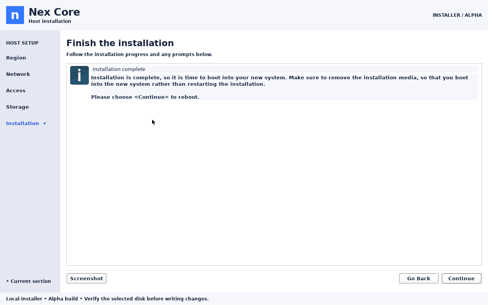
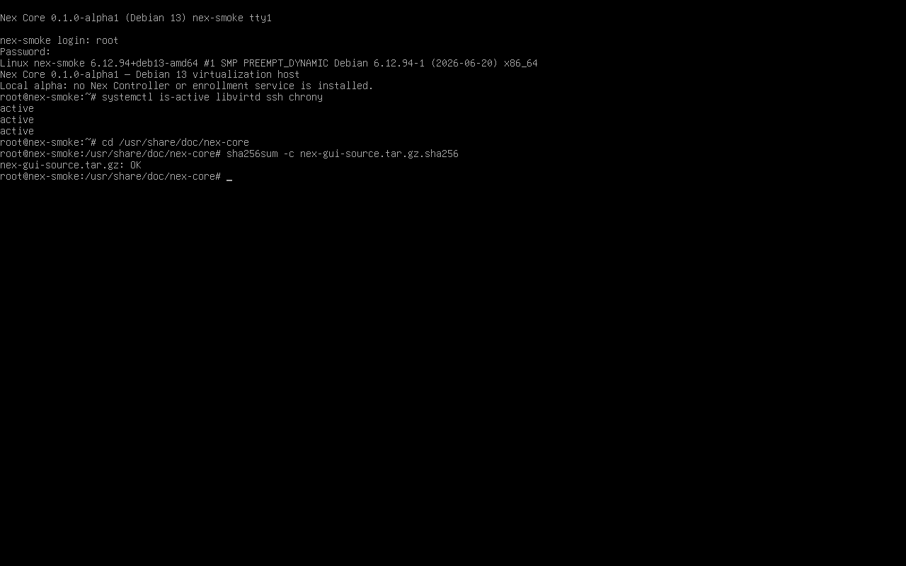

# Custom Nex installer GUI verification

Date: 2026-09-08. Nex Core 0.1.0-alpha1, local development image.

ISO: `dist/nex-core-0.1.0-alpha1-amd64.iso`  
SHA256: `3f4f7aabb2ef37cf4cb6d8b20da7c87d259be985c99818b253e0f956fa93e921`

## Correction and scope

The earlier GUI option exposed Debian's stock interface and did not meet project owner's request.
This build replaces its graphical shell with original Nex code: header, section rail,
page heading/purpose, question pane, action area and safety footer. Debian's cdebconf
question widgets and installer engine remain in use; this is a custom presentation,
not a replacement disk installer or hypervisor. Minimal text and serial modes remain.

**API impact: none** — boot selection → local cdebconf frontend → existing installer
question/answer flow → installed host. No Controller operation, Core agent command/result
or client-facing API exists. The unchanged upstream cdebconf ABI is pinned to 0.280.
**Guide impact: updated** — custom screen layout, section indicators and evidence.



## Build and focused checks

- Rebuilt the Debian builder and ISO successfully. Compiler/development packages remain in
  the builder; the GTK module uses libraries already present in the graphical initrd.
- `installer/build-gui.sh` obtains cdebconf 0.280 from authenticated APT source metadata,
  preserves BSD notices, builds the custom module and checks the initrd package ABI.
  APT authenticates the downloaded source; `dpkg-source` separately warns it cannot check
  the maintainer signature because that key is not installed. No maintainer-signature
  verification claim is made.
- `python3 tests/integration/installer-shell.py` passed 12 checks compiling the actual C
  classifier: known namespaces, password/disk errors, blank/unknown tags and rescue.
  Unknown questions remain visible without an invented completed or current section.
- The complete GTK module compiled with the upstream warning/error flags.
- Exact upstream and modified source/build configuration, plus checksum and BSD notice,
  are included as `nex-gui-source.tar.gz` and accompanying files on the ISO. This does not
  close the separate whole-image [redistribution gates](../../LICENSING.md).

## Firmware and console interaction

```sh
python3 tests/integration/installer-modes.py dist/nex-core-0.1.0-alpha1-amd64.iso \
  --output .cache/nex-iso/qa-custom-menus
```

The actual ISO boots in diskless VMs with two vCPUs, 4 GiB RAM and no NIC. BIOS uses KVM;
UEFI uses OVMF/TCG. Both GUI and minimal menu selections reached their language screens,
and keyboard Enter advanced to location. QMP capture execution passed; inspected captures
establish the visible result. The custom shell remained after media/component loading in
subsequent account and disk checks. This native GTK UI uses QMP console interaction and
screenshots, not a browser renderer or a mocked web preview.

A separate diskless KVM VM used the shipped kernel/initrd and preseed, with
`-vga none -device VGA,xres=800,yres=600`. Its 800×600 language, location and keyboard
screens were exercised with Enter; the header, rail, scrolling questions and buttons fit.
The first attempt using only `video=800x600` stayed at 1280×800 and is not small-screen
proof. Commands/captures remain in `.cache/nex-iso/qa-custom-small/`.



## Account and disk safety walkthrough

A separate BIOS/KVM VM has two vCPUs, 4 GiB RAM, no NIC and a newly created 24 GiB
regular-file disk. Test-only answers skip initial locale/network/time questions, using the
existing `iso-smoke.py` archive helper, then load the shipping preseed from the actual ISO.
Root, disk and bootloader questions are interactive. This is focused testing, not a claim
that every initial question was manually answered. The command, test initrd, disk and
captures remain in `.cache/nex-iso/qa-custom-dialog/`.

Observed using real keyboard input and a test USB mouse:

- No NIC: continue with **no ethernet card**.
- Root password and confirmation display in the Nex Access section.
- Blank input shows **Empty password**; mismatched values show **Password input error**.
  Both retain the fields for retry. Valid matching values advance directly to partitioning.
- Storage asks for an explicit target, showing `vda` and 25.8 GB decimal capacity.
- Final confirmation names the disk and ext4/swap formatting, defaults to **No**, and
  returns to the partition editor when declined.
- Returning and accepting **Yes** starts writing only the selected disposable disk.
- The custom shell remains present through progress and explicit GRUB target selection.








## Installation result and documentation checks

The offline graphical installation reached **Installation complete** after selecting
`/dev/vda` for GRUB and successfully running the shipping Nex late hook.



After Continue triggered reboot, the VM was restarted from its installed disk only,
without ISO, kernel or test initrd. Local root login succeeded; Nex identity was visible;
`systemctl is-active libvirtd ssh chrony` returned three active services. The installed
`nex-gui-source.tar.gz.sha256` check returned `OK`. This proves the focused graphical
account-to-installed-host path; initial locale/network answers were supplied as stated above.



The ISO checksum passed. The embedded Nex recipe and custom frontend source match the
working files byte for byte; the upstream BSD notice is retained. `installer/check.sh`
and all 13 documentation-checker unit tests passed, as did `check_docs.py --all`.
Git-range coverage/hosted CI were not run for this uncommitted, unpushed local change.

## Review and limits

Independent source review found no safety/ABI blockers. Independent inspection of the
800×600 keyboard screen and password, disk and progress captures found no material clipping,
overlap or missing controls. The reviewer inspected evidence; root performed interactions.

Full UEFI installation, physical hardware/Secure Boot, multiple-disk correctness, all
translations, screen-reader behavior, and a completely manual initial-network-to-login
workflow remain unverified. Section names/purpose text are currently English; native question
translations remain available. The whole Phase 0/3 and external-release gates remain open.
