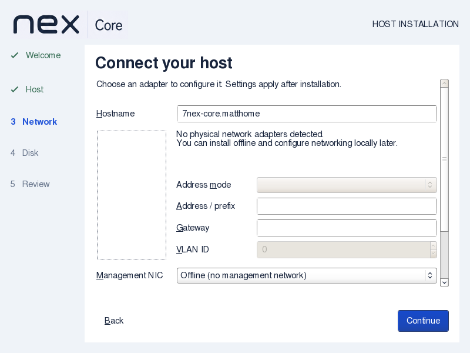
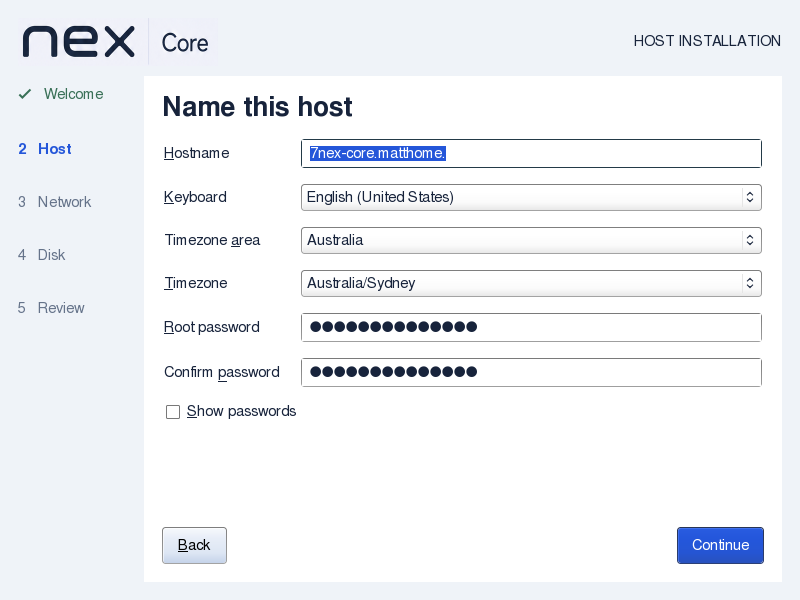
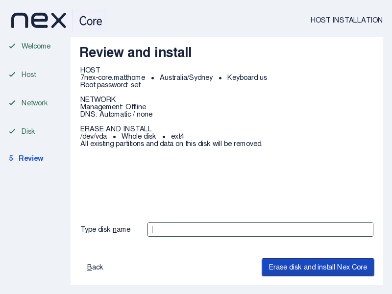

# Installer hostname standards and verification

Nex Core 0.1.0-alpha1, 2026-09-08.

## Standards decision

`nexcore.matthome` is valid ASCII hostname syntax. The previous GUI and backend both
restricted input to one label, rejecting it.

- [RFC 1123 §2.1](https://www.rfc-editor.org/rfc/rfc1123.html#section-2.1) permits digit-leading labels; accept short and qualified ASCII names with letters, digits and internal hyphens.
- [RFC 1035 §§2.3.1–2.3.4](https://www.rfc-editor.org/rfc/rfc1035.html#section-2.3.1) defines case-insensitivity and the 63-byte label/255-byte DNS wire limits. With length bytes and root label, ordinary text is at most 253 bytes excluding a final dot.
- [RFC 1034 §3.1](https://www.rfc-editor.org/rfc/rfc1034.html#section-3.1) defines the final root dot in absolute textual names. Accept one and remove it for installed configuration.
- Private suffixes do not need public registration or a DNS lookup. Numeric labels remain supported; the UI does not require an alphabetic public TLD. IP-address literals, whitespace, underscores, empty labels and edge hyphens are rejected.
- This is the ASCII hostname profile, including `xn--` spelling. Unicode input requires its ASCII IDNA form; no claim of Unicode/IDNA2008 validation is made. [RFC 5890 §2.3.2.1](https://www.rfc-editor.org/rfc/rfc5890.html#section-2.3.2.1) distinguishes Unicode and ASCII labels. Existing [GLib hostname conversion](https://docs.gtk.org/glib/func.hostname_to_ascii.html) is not used as a substitute for full IDNA2008 validation.
- [Debian hostname(5)](https://manpages.debian.org/trixie/systemd/hostname.5.en.html) recommends a short static name. Split qualified input into that first label and the remaining domain; retain the full name plus short alias in `/etc/hosts`.

API impact: none. Shared local validation changes accepted installer input, not any
Controller operation, agent command/result or client-facing API. Guide impact: updated.

## Verification

ISO SHA256: `21f83a2fe9310886d93b94d3d764055863c27219939d2c5ab65858b5ce8811da`.
Matching checksum, complete-initrd checks, and retained wizard/config source comparisons passed.

- Strict C hostname/network regression passed: short and qualified names, mixed case,
  digit-leading/numeric labels, ASCII Punycode, single root-dot normalization, 63/64-byte
  label boundaries, 253/254-byte full-name boundaries, and invalid separators/characters/IPs.
- `installer-hostname.py` passed. It compiles the actual backend output block with an
  in-memory file boundary and checks generated short hostname, full/short hosts aliases,
  and separate Debian hostname/domain answers. This is simulation, not an installed boot.
- Existing keyboard, QoL, protected handoff and installer-mode checks passed.
- Native `wizard-review.py` passed using the final ISO kernel/initrd with the test-only
  preparation marker, QEMU/KVM, 4 GiB RAM, no NICs, 800×600 and a disposable 24 GiB raw
  disk. Host accepts `nexcore.matthome`; Network rejects underscore input and then accepts
  `7nex-core.matthome.`. Returning to Host retains the edited value, including its final dot; continuing
  validates and removes that dot, so Review shows `7nex-core.matthome`. Password reset and wrong-disk confirmation checks still pass; the
  disk's first 1 MiB remains untouched. The test VM was stopped.
- Documentation structure and whitespace checks passed. Both GitHub and Gitea installer
  workflows invoke the shared boundary, backend and native regressions on push/PR.
  Hosted execution and clean-commit documentation range coverage remain unclaimed.
- Independent source review found no blocking issues and separately reran the compiled
  boundary and backend-generation checks successfully. Independent native visual review
  also passed the accepted name, shared edit, invalid-input recovery and normalized review.

No full installation/reboot, physical hardware or DNS-server registration was tested in
this slice. Existing target-file delivery remains unchanged; the new output contents were
checked through the actual renderer at a simulated file boundary. Local hosts aliases do
not create a DNS record for other machines.
