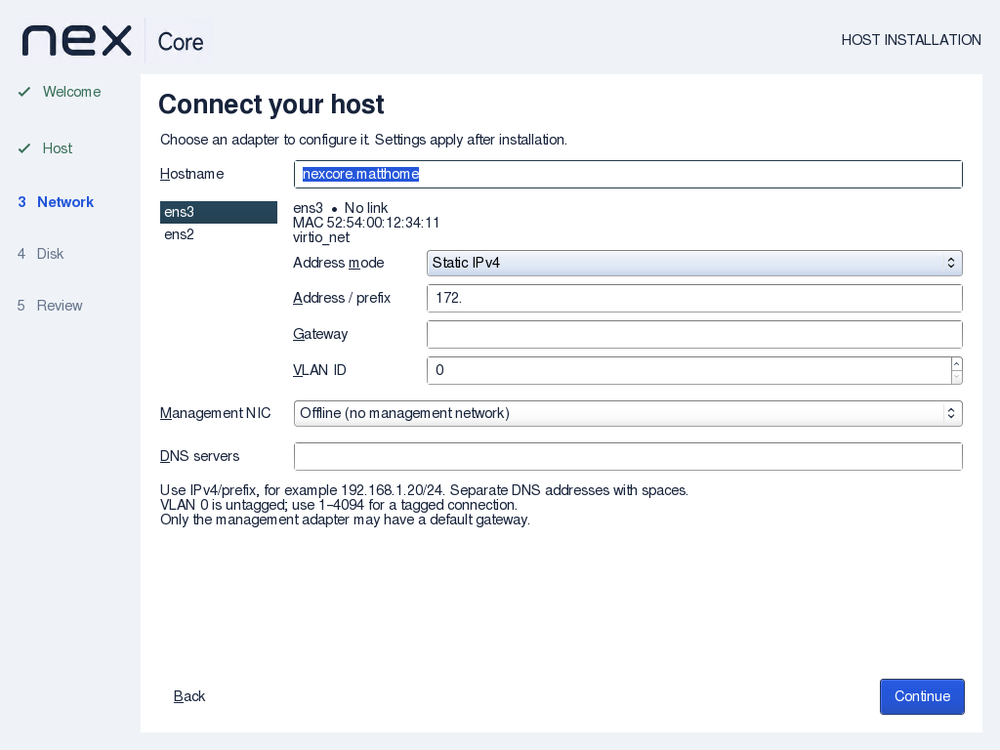
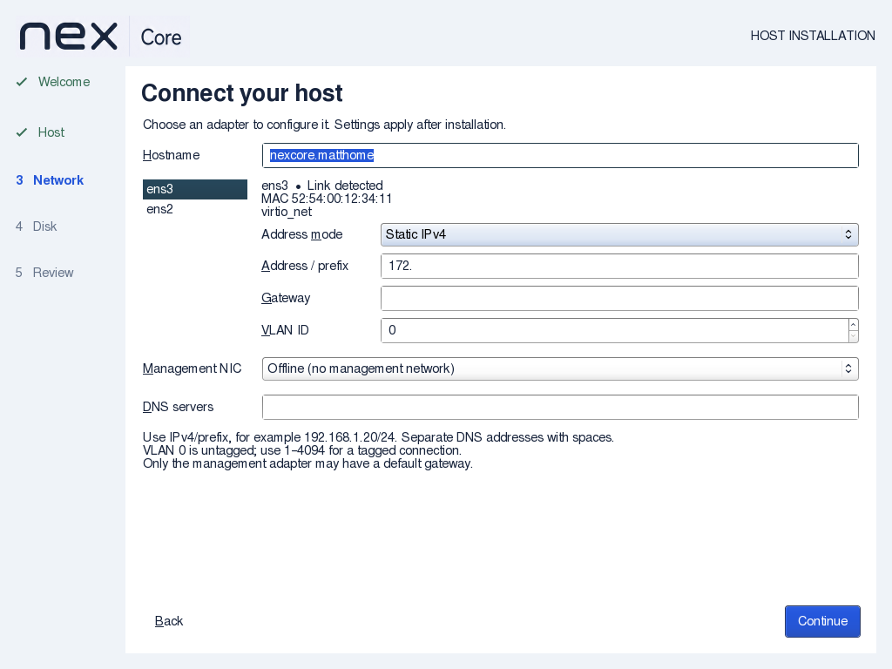
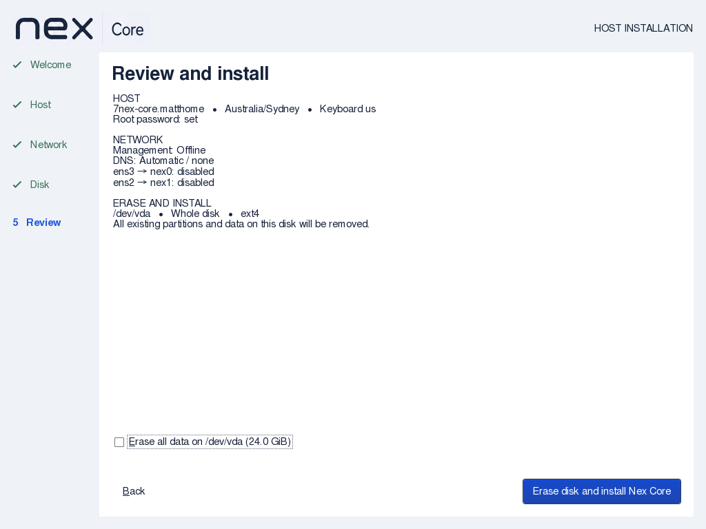

# Installer link-status verification

Nex Core 0.1.0-alpha1, 2026-09-08.

The earlier Network page exposed Linux operstate `down`, which did not distinguish an
administratively disabled adapter from absent carrier. Read actual carrier after a local
link-only probe, and refresh without reloading or losing the current NIC form edits.
[Linux operational-state documentation](https://docs.kernel.org/networking/operstates.html)
explains the administrative/link distinction.

API impact: none. Local carrier observation and probe use no Controller operation, agent
command/result or client API. Saved target network configuration is unchanged.
Guide impact: updated. The same slice replaces confusing device-name typing with an
initially unchecked erase checkbox naming the selected disk and capacity. Consent resets
on returning to Review or changing disks; backend disk identity validation is unchanged.

## Artifact and results

ISO SHA256: `4300dc11aa39df3d4ab835695855dfa8397ef4eee08c9d16c4a041f1cdd033d3`.
Checksum, retained wizard-source comparison and complete-initrd/script checks passed.

Strict GTK compilation, `installer-link.py`, protected handoff and installer mode/syntax
checks passed. The link regression compiles actual status/refresh callbacks with simulated
GTK/sysfs boundaries, and executes the actual shell probe with simulated interfaces.
It covers valid carrier, unknown/admin-down/malformed values, speed handling, IPv6
suppression before enabling, preservation of already enabled interfaces, and suppression
or activation failure. A temporary source mutation replacing carrier with operstate fails
the regression; the live source was not modified by that negative control.

Actual QEMU/KVM walkthrough at 800×600 with no NICs passed, using the final ISO kernel/initrd,
4 GiB RAM and a fresh 24 GiB raw-file disk. Checked confirmation is visibly active; returning
to Review resets it, and unchecked installation attempts are rejected while the disk’s first
1 MiB remains untouched. All actions stay visible. The VM was stopped after the test.

The 1024×768 two-virtio-NIC walkthrough observed Link detected → No link → Link detected
following QMP virtual cable changes, while the Static IPv4 selection and partial `172.`
address remained intact. The test-only post-preparation observation confirmed no non-loopback
IP addresses or routes. The complete 1024×768 run passed, including checkbox activation/reset and rejection
without disk writes. An initial test run needed a test-only input fix: select the address
mode dropdown explicitly instead of relying on a duplicate mnemonic. The final run used
the same ISO; no product code or artifact changed. The disposable VM was terminated.

Independent source and native visual review found no blocking issues. Documentation
structure and whitespace checks passed; both GitHub and Gitea workflows invoke these
regressions on push/PR. Hosted CI and clean-commit range coverage are not claimed.

## Limits

These are virtual link observations, not physical cable or switch/VLAN/IP reachability tests.
A virtual NIC can have carrier while the physical hypervisor uplink is disconnected.
Already-enabled interfaces are preserved; the probe does not remove existing boot-environment
configuration. Newly probed interfaces receive no addresses from this probe, with IPv6
autoconfiguration suppressed before activation. Driver/probe failures display Link unknown.
Full installation/reboot was not repeated for this slice; staged target IP settings still
apply after installation. No production disks or live infrastructure were touched.
