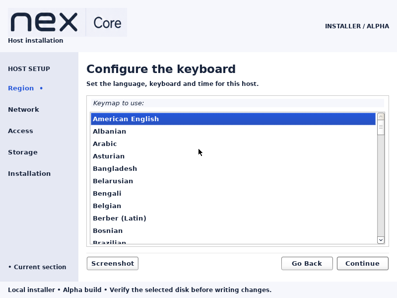

# Nex Core installer logo verification

Date: 2026-09-08. Artifact: Nex Core 0.1.0-alpha1 amd64 ISO.
SHA256: `031c8963fa651a67c1fbaf590632838e9b07cbe71ea530145cac03ae6d2561a5`.

## Scope and method

Replace the placeholder typed letter and system-font name with the approved Core
lockup from `docs/brand/nex-brand.png`. GTK crops the original board at
45,510 (400×96) and scales to 240×58. The original raster is retained in the
modified frontend source archive. Vector master preparation remains outstanding.

Built with `sudo -n docker` using the existing installer build pipeline. Booted the
rebuilt image's staged kernel and complete GTK initrd with the ISO attached in a
disposable QEMU/KVM VM: 2 CPUs, 4 GiB RAM, 800×600 VGA, no disk and no network.
Used QMP keyboard input to advance English → United States → keyboard selection.
Inspected actual native GTK framebuffer captures at language and keyboard screens.

## Results

The approved logo renders with its complete Core descriptor; the previous blue
letter tile is gone. Title, keyboard list, sidebar and navigation controls remain
visible at 800×600. Keyboard navigation advances successfully.

The first attempted image boot showed the plain-text fallback because the overlay
archive included files without the new artwork directory. Including directory
entries before files corrected kernel initramfs extraction; the final boot above
confirms recovery. `tests/integration/installer-logo.py` passes against the complete
concatenated GTK initrd, checking directory order and exact approved artwork bytes.
`installer/check.sh` and `tests/integration/installer-shell.py` pass. The rebuilt ISO
SHA256 matches its sidecar. Source archive comparison confirms exact artwork and
frontend shell retention. `python3 scripts/check_docs.py --all`, all 13 documentation
checker unit tests and `git diff --check` pass. Git-range coverage and hosted CI
were not run because this work remains uncommitted and unpushed.

## Limits and impact

This is native GTK VM verification, not a browser mockup or physical-hardware test.
No disk writes or full installation were exercised on this logo-only rebuild;
[earlier custom installer QA](2026-09-08-custom-installer.md) records the prior
artifact's full installation and recovery checks. UEFI and fallback behavior were
not re-exercised on the final artifact. The first failed boot did exercise text
fallback. External distribution licensing/source gates remain open as documented
in [licensing](../../LICENSING.md).

API impact: none. Header rendering and initrd packaging do not change Controller
operations, Core commands/results, client APIs or Debian question contracts.
Guide impact: none. Installation choices and operator steps are unchanged.
