# GUI and minimal installer verification

Date: 2026-09-08. Nex Core 0.1.0-alpha1, local development build.

ISO: `dist/nex-core-0.1.0-alpha1-amd64.iso`  
SHA256: `8fc53ba1706d864dacd11d281575514a46c790f03dc216ed2b37ea079394706c`

## Scope

Both firmware menus offer **GUI install - Nex Core** and **Minimal install - Nex Core (text)**,
plus the existing serial and rescue options. They wait for selection. GUI uses the bundled
Debian GTK installer; minimal uses its text frontend. Both install the same headless Nex host
through the same preseed and hooks. This is not a custom graphical shell or an installed desktop.
The native wizard retains Debian's banner. No dependency or upstream executable was added or
modified for this choice. Upstream notices and existing redistribution gates still apply.

**API impact: none** — boot menu → Debian frontend → shared local preseed/hooks → installed
OS; no Controller operation, Core agent command/result or client-facing API exists here.
**Guide impact: updated** — frontend selection, controls and graphics fallback.
The [Debian installer reference](https://www.debian.org/releases/trixie/amd64/ch05s01.en.html#graphical)
describes the shared frontend behavior. Actual bundled `isolinux/gtk.cfg` confirmed the shared
`/install.amd/vmlinuz`, `vga=788`, and `/install.amd/gtk/initrd.gz` boot inputs.

## Build and focused checks

- Debian container build and ISO build completed, including signature and pinned checksum verification.
  This workstation required `sudo -n docker` to access its Docker socket; the normal build recipe
  ran in that container, with output ownership set to the invoking user.
- `./installer/check.sh` passed menu parity, shared preseed, serial/rescue, disabled timeout,
  shell syntax, account/disk/network policy and offline package checks.
- `python3 tests/integration/root-account.py .cache/nex-iso/stage/pool/main/u/user-setup/user-setup-udeb_1.107_all.udeb`
  passed the native account-script checks with mocked debconf transport (valid/blank/mismatch,
  initialization, idempotency, and rejection of changed upstream code).

- The ISO SHA256 sidecar check passed, and the embedded `installer/` source archive
  matches the working-tree installer files byte for byte.

## Real menu and frontend interaction

```sh
python3 tests/integration/installer-modes.py dist/nex-core-0.1.0-alpha1-amd64.iso \
  --output .cache/nex-iso/qa-modes-menus-2
```

The check boots the actual ISO without any disks or NICs, with two vCPUs and 4 GiB RAM.
BIOS uses QEMU/KVM; UEFI uses OVMF with TCG. QMP sends the actual menu selection and Enter
at language selection. This is native GTK/text UI interaction, not browser simulation.
A browser is not the renderer for this installer. PPM captures are converted losslessly to
PNG for inspection. The script only proves capture execution; visual inspection establishes
which screen appeared. Command JSON and logs remain in the output directory.

The first local run used KVM for UEFI and captured a stalled firmware splash, so those UEFI
captures are rejected as evidence. The checked-in script uses TCG for UEFI; no ISO changes
were needed to address this lab firmware limitation.

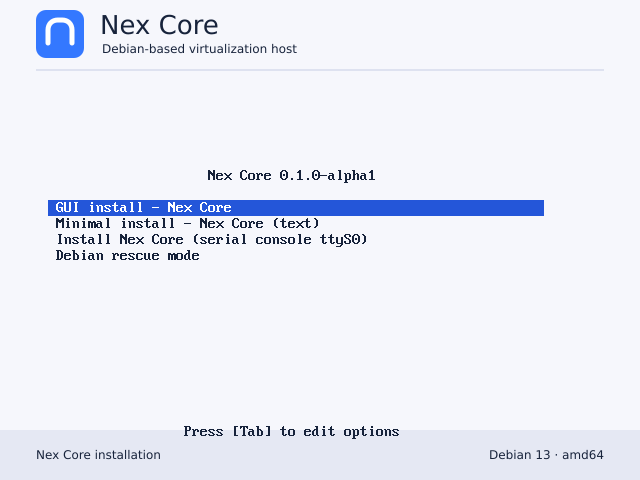
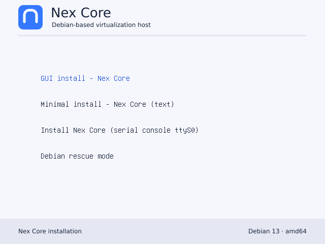
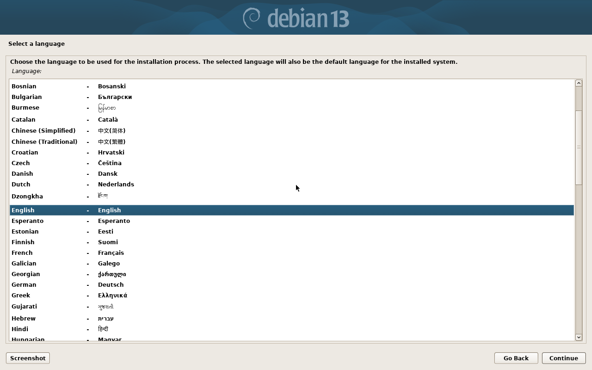
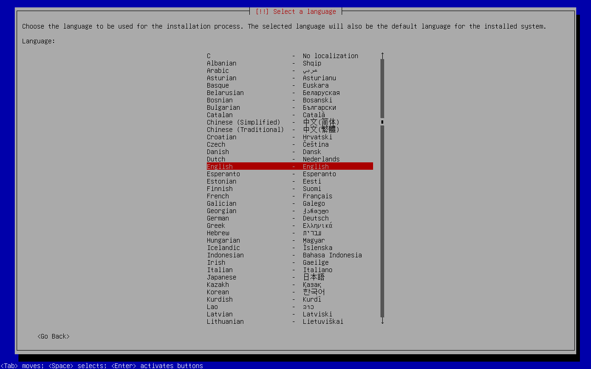

All four BIOS/UEFI frontend selections reached the expected language screen; Enter
advanced each to its location screen. The captures were inspected for readability and
correct frontend selection. The command completed successfully.

## Interactive graphical account and disk checks

A separate BIOS/KVM VM uses one newly created 24 GiB regular-file disposable disk, 4 GiB RAM,
two vCPUs and no NIC. A test-only GTK initrd uses the existing `iso-smoke.py` archive helper
to supply locale, keyboard, network-disabled and clock answers. It loads the shipping preseed
from the ISO after media detection. Root-password, partitioning and bootloader answers remain
interactive. The test kernel arguments are `auto=true priority=high vga=788`, without a serial
console frontend. This skips initial questions for focused testing; it is not a complete manual
walkthrough of every shipping question. The command, initrd and captures are retained locally
under `.cache/nex-iso/qa-modes-dialog-2/`.

Inspected and exercised through QMP keyboard input and a test USB mouse:

- A missing-NIC screen can continue with **no ethernet card**.
- Root password and confirmation appear together, with Nex's root-only/local-console wording.
- Submitting both blank shows **Empty password** and permits retry.
- Different password values show **Password input error** and permit retry.
- Matching nonempty values advance directly to partitioning, without ordinary-user questions.
- Guided partitioning asks for an explicit disk and displays its device and capacity.
- Final formatting confirmation names the affected disk/partitions and defaults to **No**.
  Continuing with **No** returns to the partition summary. Returning to confirmation and
  selecting **Yes** starts installation on the selected disposable disk only.
- Keyboard navigation and a mouse click were exercised; text and controls in inspected
  screens were readable. This is not screen-reader certification.

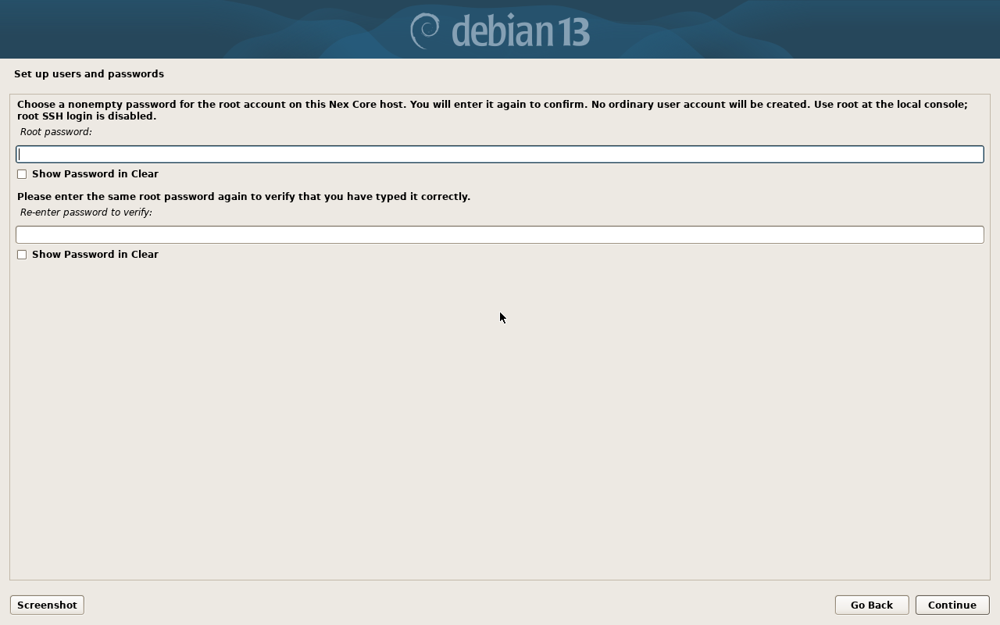
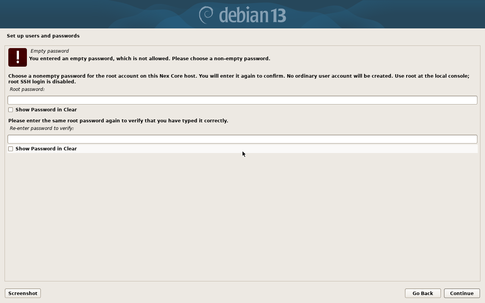
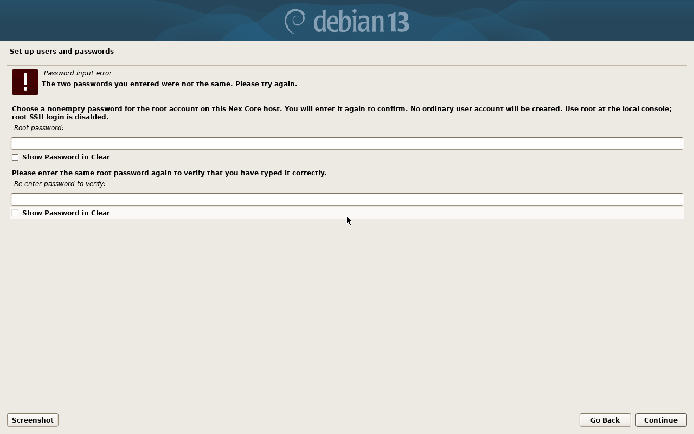
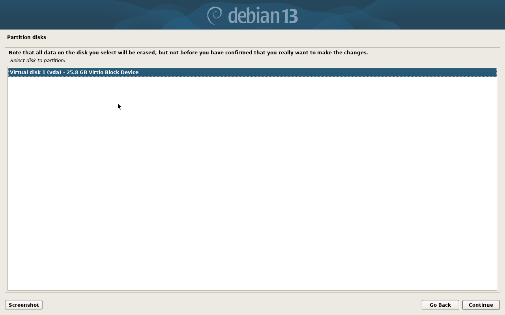
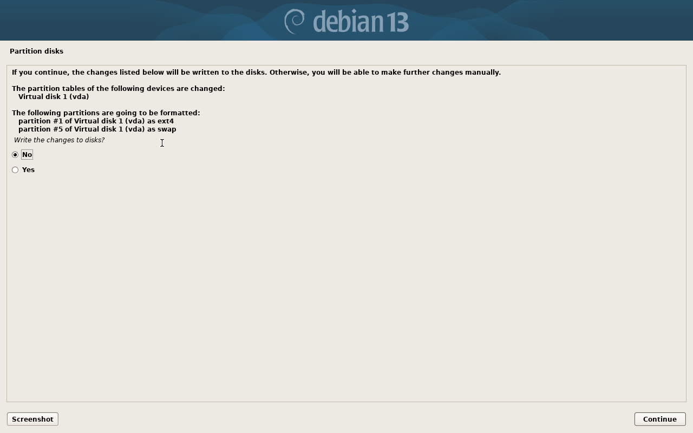
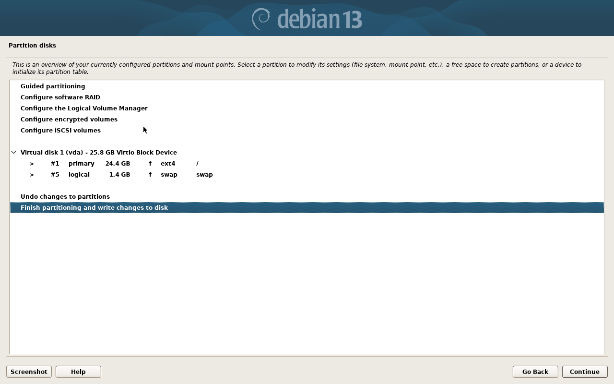

The graphical workflow continued with GRUB installation onto `/dev/vda` and reached
**Installation complete** after the shipping Nex late hook ran successfully, with no NIC.

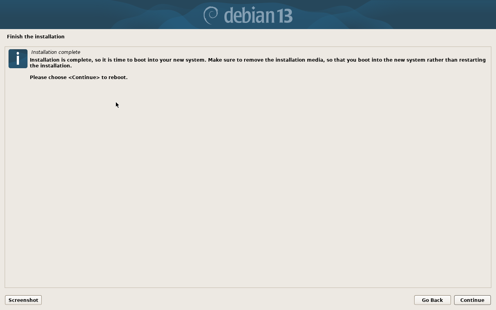

After Continue triggered reboot, the VM was restarted from the installed disk alone,
with no ISO, kernel or test initrd attached. Local root login with the chosen password
succeeded, Nex Core identity was visible, and `systemctl is-active libvirtd ssh chrony`
reported three active services. This completes the focused graphical account-to-installed-host
path; the initial locale/network questions were supplied by the test setup as stated above.

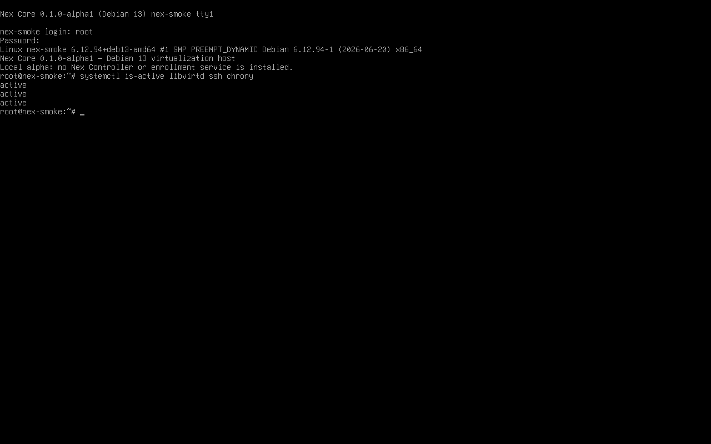

## Offline installation and installed-host checks

```sh
python3 tests/integration/iso-smoke.py dist/nex-core-0.1.0-alpha1-amd64.iso \
  --output .cache/nex-iso/qa-modes-install \
  --kernel .cache/nex-iso/stage/install.amd/vmlinuz \
  --initrd .cache/nex-iso/stage/install.amd/gtk/initrd.gz
```

Passed, exit zero: offline installation, media removal, installed first boot and reboot.
The serial logs contain `NEX_SMOKE_INSTALL_PASS`, `NEX_SMOKE_ROOT_ONLY_PASS`,
`NEX_SMOKE_IDENTITY_PASS`, `NEX_NESTED_KVM_BOOT_PASS`, `NEX_SMOKE_FIRST_BOOT_PASS`, and
`NEX_SMOKE_REBOOT_PASS`. The existing assertions checked services, root password/no ordinary
users, identity preservation after base-files reinstall, and a nested KVM guest boot.

This test uses the GTK payload but explicitly selects the serial console and injects test-only
answers. It proves offline payload/installed-host behavior, not a manual graphical installation.
Its initial UEFI capture used KVM and is not accepted; the separate TCG menu check above owns
UEFI frontend evidence. These distinctions do not invalidate its BIOS installation checks.

## Documentation and review

`python3 scripts/check_docs.py --all` passed; all 13 documentation-checker unit tests
passed. `git diff --check` passed. Independent review found no scope, API/guide,
implementation or visual defects in the menus, frontend screens and password/disk captures.
Git-range documentation coverage and hosted CI were not run: this is an uncommitted local
change, with no push. The scoped assessment inventories this installer batch only.

## Limits

Physical hardware, Secure Boot, full UEFI installation, multiple-disk safety, screen-reader
coverage, and the complete manual language/network-to-installed-login workflow remain open.
The broader Phase 0/3 gates and external redistribution gates remain open. Simulated disk/UI
checks do not certify real storage or hardware recovery.
