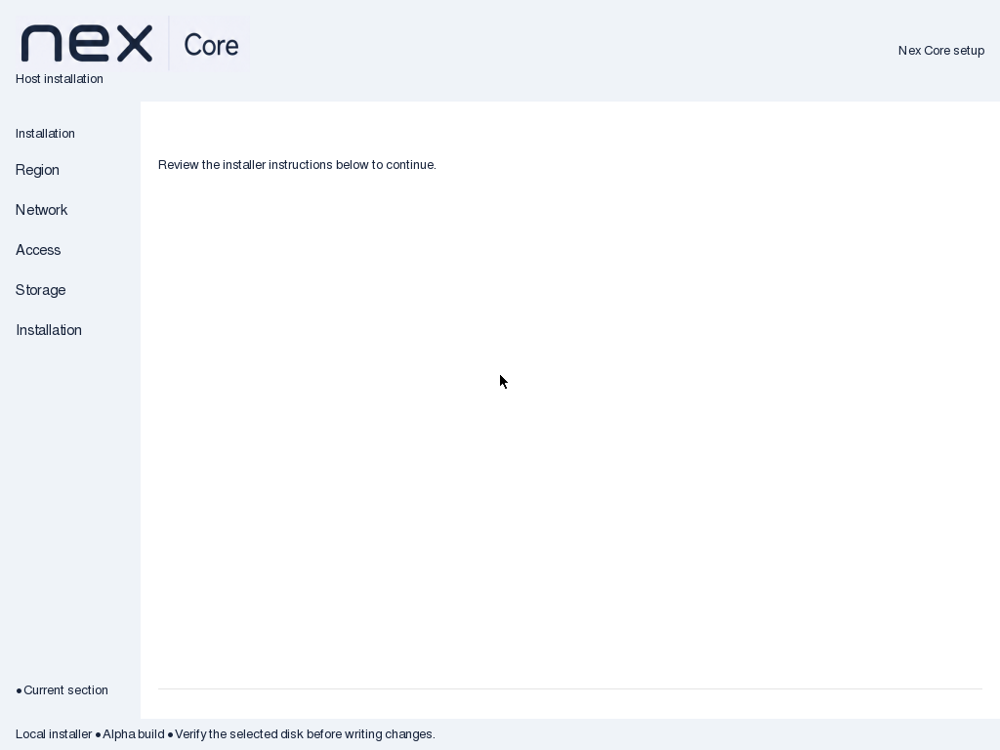
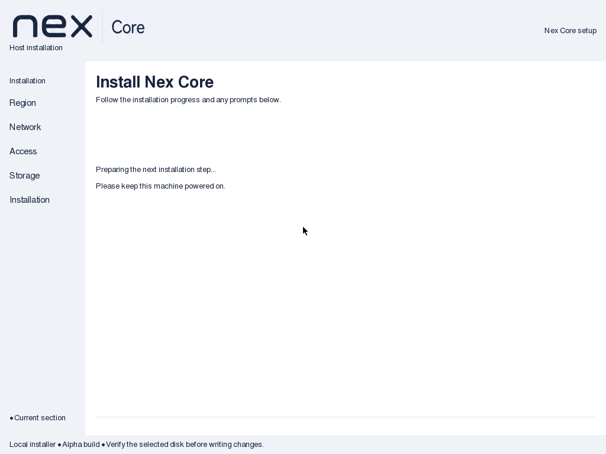
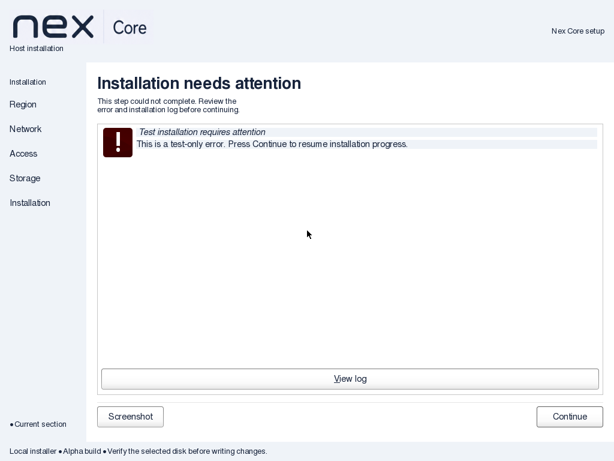
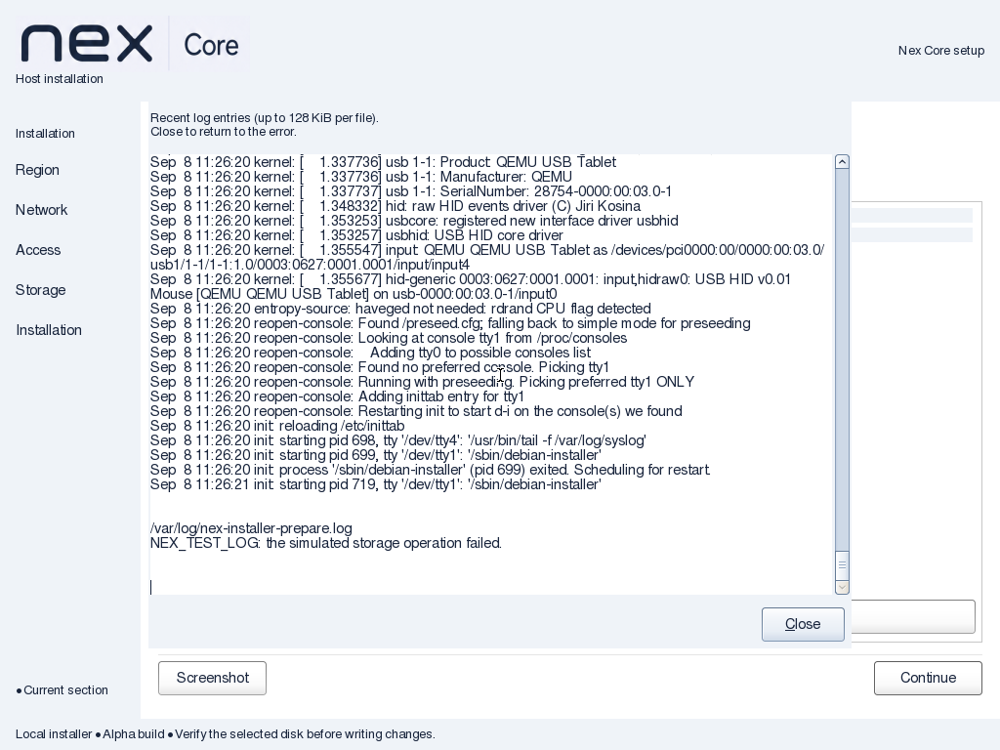
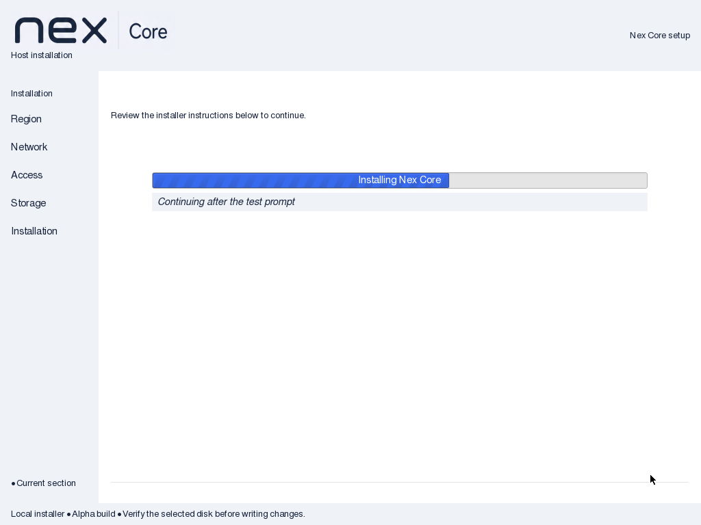
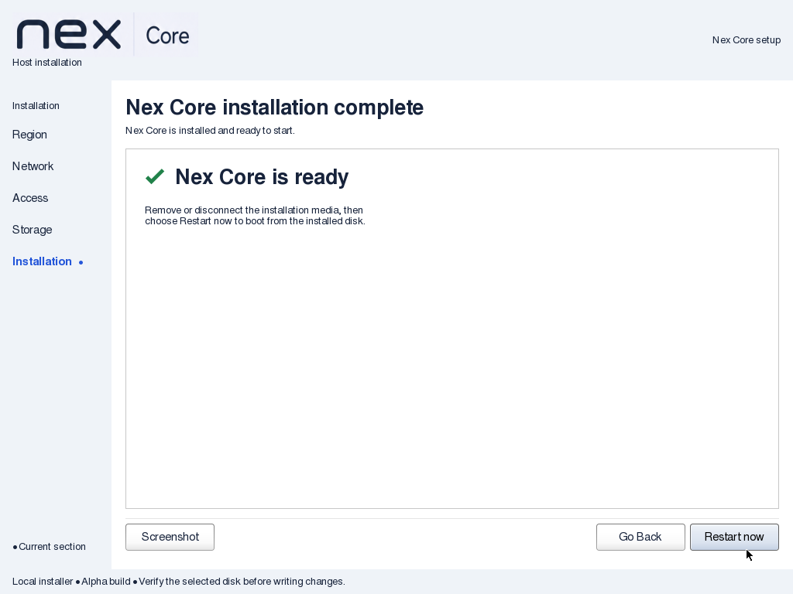

# Installer progress, completion and failure verification

Date: 2026-09-08. Nex Core 0.1.0-alpha1.

API impact: none; local cdebconf GTK presentation and completion-note preseed only.
No Controller operation, agent command/result or client-facing API changes. Guide impact: updated.

## Artifact and source checks

Final ISO SHA256: `e4ab0825ccec83adecaf9a2e9877bc77610c23bb2d03ac9ed69eb02677f22a3a`.
Build, checksum, retained shell source comparison and complete-initrd checks passed.
Pinned frontend and strict config compilation passed. Existing shell/phase, handoff,
hostname/preseed and installer mode/syntax checks passed. The preseed test requires the
final note to remain unseen, preventing automatic acknowledgement.

The actual log reader is covered by `installer-shell.py`: missing files, empty files,
bounded 128 KiB tails and invalid UTF-8 conversion passed. No new log sink or credentials
logging was introduced. Logs are existing local diagnostics and are not redacted by
the viewer. Both installer CI workflows run the source checks and native protocol test.
Hosted CI was not run.

## Native protocol reproduction and regression

A diskless QEMU/KVM guest used the shipping GTK frontend and test-only scripted debconf
commands. The old initrd reproduced the blank body after PROGRESS STOP: only 54 dark
pixels from the pointer in the tested body region, versus 2100 during active progress.
The original regression failed on that blank interval. It also exercised a genuine
cdebconf error question and progress resumption.

The final native run passed at 1024×768 with no disk attached. Waiting content appeared
after component STOP and after the last progress task. The error reason remained visible;
Alt+V opened the read-only log at the latest entries, including the synthetic preparation
error marker. Ctrl+Home changed the view and Ctrl+End restored the initially shown tail.
Escape returned to the unchanged error; Continue acknowledged it and real progress resumed.
The custom Nex completion page remained blocking until restart acknowledgement.
All captures below were inspected. The guest was terminated after the test.

An earlier log-viewer capture exposed startup entries instead of the latest entries.
A one-shot GTK idle callback now waits for layout before focusing and scrolling; the
strengthened native keyboard/initial-tail assertions passed on the final ISO.

## Actual installation and explicit restart

The preceding custom-completion ISO, SHA256
`dd6ac0344213e447a9cdf17cff1377e5a5f679208c40d97f0c046e7052015cd9`,
passed `wizard-review.py --resolution 1024x768 --nics 2 --capture-completion` using
QEMU/KVM, 4 GiB RAM and a fresh 24 GiB raw-file disk. It performed the real installation,
reached the native final stage, stayed running for 3 seconds without acknowledgement,
then exited naturally with status 0 under QEMU's no-reboot setting after clicking
Restart now. The test-only hook emitted a marker before the native final prompt; it
did not manufacture success or replace the installer. Final cleanup/unmount/reboot
follow acknowledgement. `completion-result.json` recorded all three assertions true.

The final ISO adds error diagnostics; its completion implementation is unchanged.
The custom completion and final restart were not reinstalled after that diagnostics-only
addition. An earlier intermediate ISO also completed with no NICs after manually
acknowledging Debian's no-Ethernet prompt; the two-NIC run needed no manual intervention.

## Limits

The final controlled protocol test simulates component commands, not a real failing
disk/install or complete installation. Log test entries are synthetic. The separate
full installation above proves the ordinary final gate and restart, not every hardware
or failure scenario. This is Debian's existing completion gate, not independent installed
host certification; some final hooks log failures without aborting. Native recovery
controls remain; cancellation was source-reviewed, not exercised here.

The GUI displays failures reported through installer error questions and main-menu
component-failure handling. It cannot display a new error after power loss, a kernel
crash, or a dead graphical server. Logs are local and bounded in the viewer; missing
files report unavailable. Physical hardware, installed-host boot after restart and
hosted CI were not verified in this slice. No real disks or live infrastructure were touched.

Documentation structure and whitespace checks passed. Independent source, native capture, test and documentation review completed with no blocking findings.
