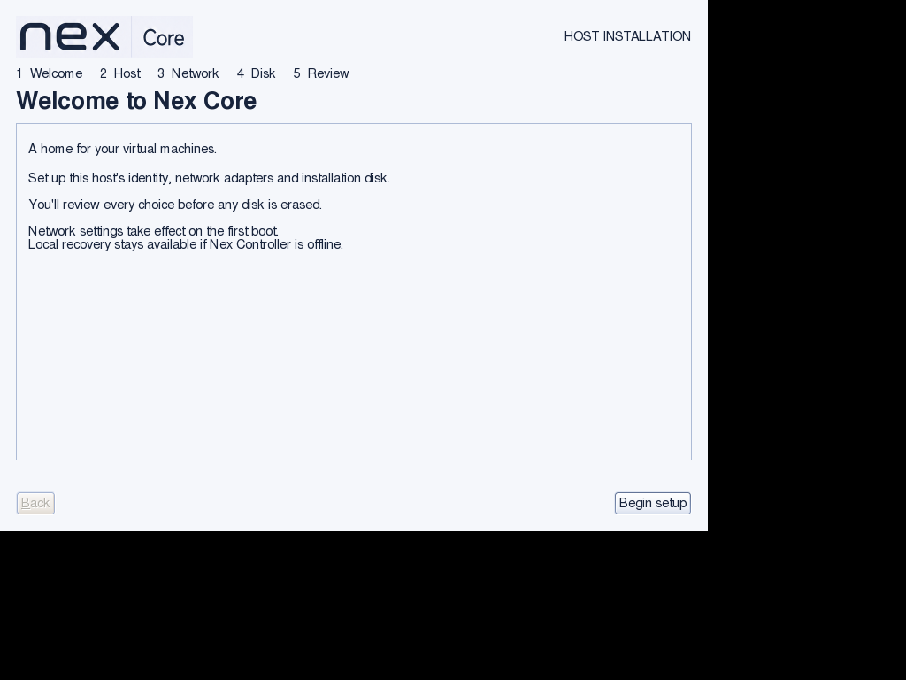
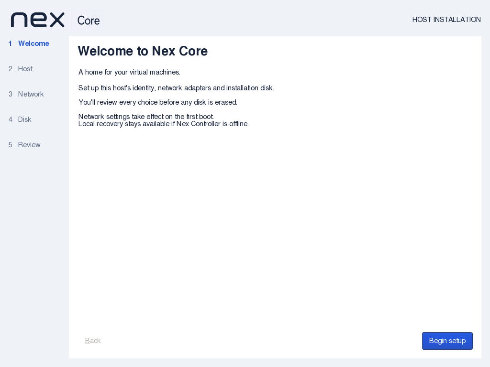
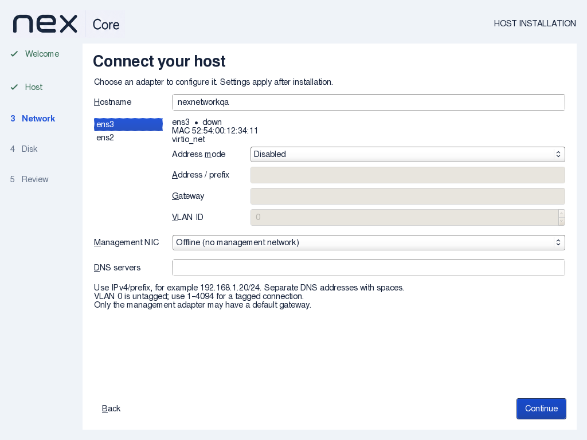
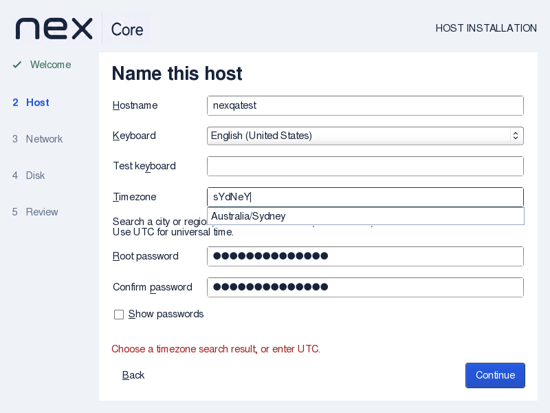
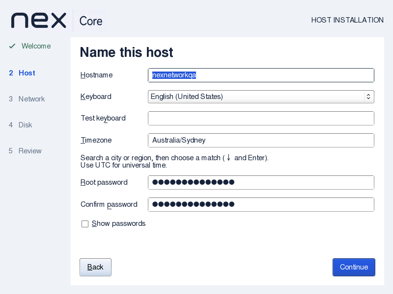
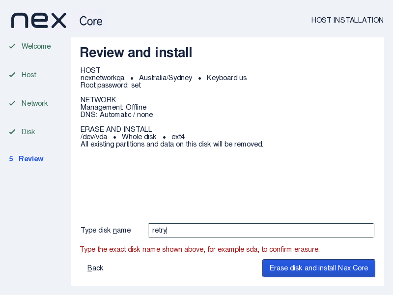
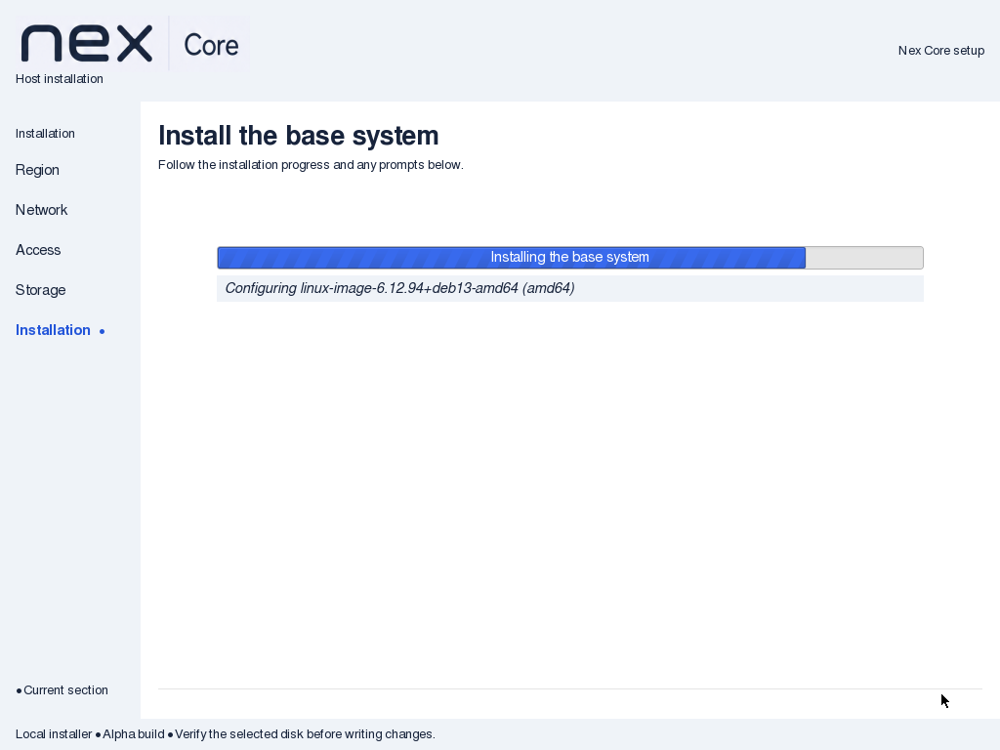

# Installer usability verification

Date: 2026-09-08. Nex Core 0.1.0-alpha1.

## Scope and artifact

project owner requested a complete modern, flat, professional installer overhaul, fullscreen
sizing, easier timezone selection, practical input improvements, and hostname editing
on Network as well as Host. This slice delivers a vertical step list, white form panel,
fixed navigation area, native scrollable content, matching installation-engine typography,
searchable timezones, keyboard testing, password visibility and shared hostname editing.

Final ISO SHA256: `9b86f74ff4a63459373fecc495f55071513166aa24aa65b96d2074ffc10db8c1`.
The retained GUI source matches the current wizard source byte-for-byte. Complete-initrd
artwork, script and merged-usr checks passed. Earlier intermediate captures established
specific fixes; the final-artifact walkthrough results are listed below.

API impact: none. Both hostname entries share one GTK buffer; the review and protected
configuration use that same value. The existing nex-config validation, Debian installation
handoff and target configuration contracts are unchanged. No Controller operation, Core
agent command or client-facing API is added. Guide impact: updated.

## Reproduced failures

The previous ISO at 1024×768 left the wizard at 800×600 with black margins. Its maximize
request required a window manager that Debian Installer does not run. Explicit screen
geometry replaces that assumption; a callback also handles screen-size changes.

The first timezone-completion build passed string-matching checks but produced no popup
in the native installer. Explicitly presenting the wizard fixed popup focus. Native
selection, not just the matching callback, is now part of the regression walkthrough.

## Native walkthrough

QEMU/KVM, 2 CPUs, 4 GiB RAM, native GTK under the installer X server, disposable 24 GiB
raw-file disks. Tests boot the actual ISO kernel/initrd with a test-only preparation
success marker; no production disk or host networking is modified.

Both final-artifact native runs exited successfully: 800×600 with no NICs and
1024×768 with two virtio NICs. Inspected framebuffer captures establish:

- The wizard fills the display; the fixed action area remains usable at both sizes.
- Typing `nEw yOrK` and selecting its result yields `America/New_York`; `sYdNeY`
  yields `Australia/Sydney`, which appears canonically in the review.
- Unsupported timezone input stays blocked with a visible correction message.
- Show passwords reveals both entries; leaving Host and returning hides them again.
- An invalid Network hostname is rejected. Changing it to `nexnetworkqa` updates
  the Host page and final review; both entries use the same value.
- Empty-NIC and two-NIC pages remain usable, including scrolling at the smaller size.
- Review content is visible. Wrong disk confirmation leaves the input usable and the
  first 1 MiB of the disposable disk untouched, as asserted by the native test.
- After the explicit disposable-disk confirmation in the 1024 run, the native engine
  reached **Install the base system** and kernel package configuration. Both test VMs
  were stopped after their checks; this is not full installation acceptance.

Commands: `wizard-review.py` with the final ISO, extracted kernel/initrd and separate
fresh output directories; default 800×600/no NICs, then `--resolution 1024x768 --nics 2
--capture-progress`. The progress option writes only the test-created regular-file disk,
after the rejection/no-write assertions and explicit disk confirmation.

## Focused checks and review

- Strict native C compilation passed.
- `installer/check.sh`, `installer-shell.py`, `installer-keyboard.py` and
  `installer-qol.py` passed. The latter compiles actual callbacks with simulated GTK
  boundaries for geometry, timezone case/space matching and both password fields.
- `check_docs.py --all`, all 13 documentation checker unit tests and
  `git diff --check` passed. Clean-commit range coverage is not claimed for this dirty tree.
- Both GitHub and Gitea installer workflows run the focused checks and native walkthrough
  at 800×600 and 1024×768 on push/PR. Hosted CI remains unexecuted; no push was performed.
- Independent source review found no material blocker; the duplicate keyboard-test mnemonic
  was corrected to Alt+Y. Independent final visual review inspected both resolutions,
  hostname synchronization, timezone selection, password reset and confirmation recovery
  without material findings.

## Limits

Live display hot-resize has callback coverage, not a physical-monitor walkthrough.
No full installation or installed-host acceptance was repeated for this presentation slice;
prior backend installation evidence remains in the [wizard report](2026-09-08-nex-wizard.md).
A native engine question/progress capture alone does not establish a completed installation.
No physical hardware, UEFI installation, Secure Boot or new networking capability is certified.
The existing IPv4-only editor, one VLAN per NIC and whole-disk GUI limits remain.
