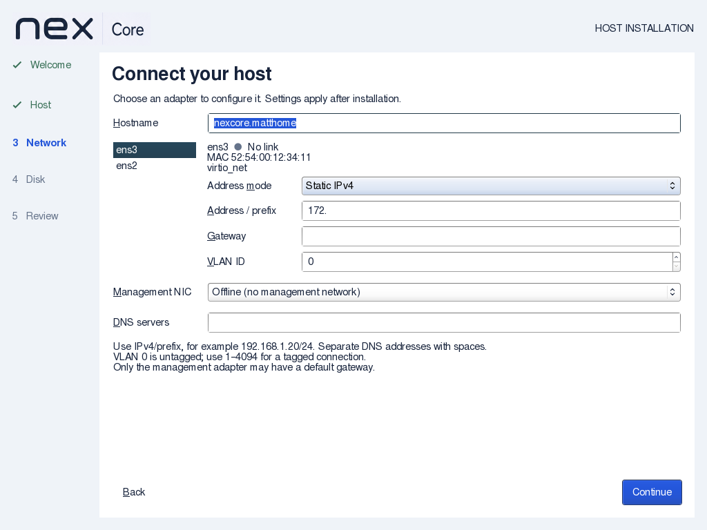
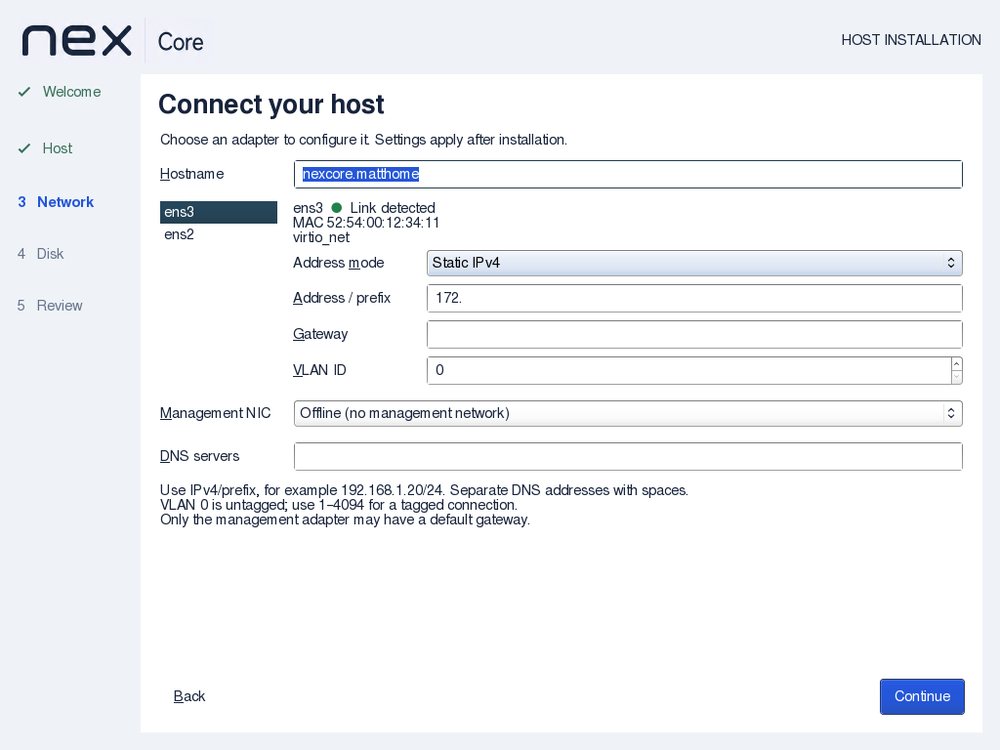
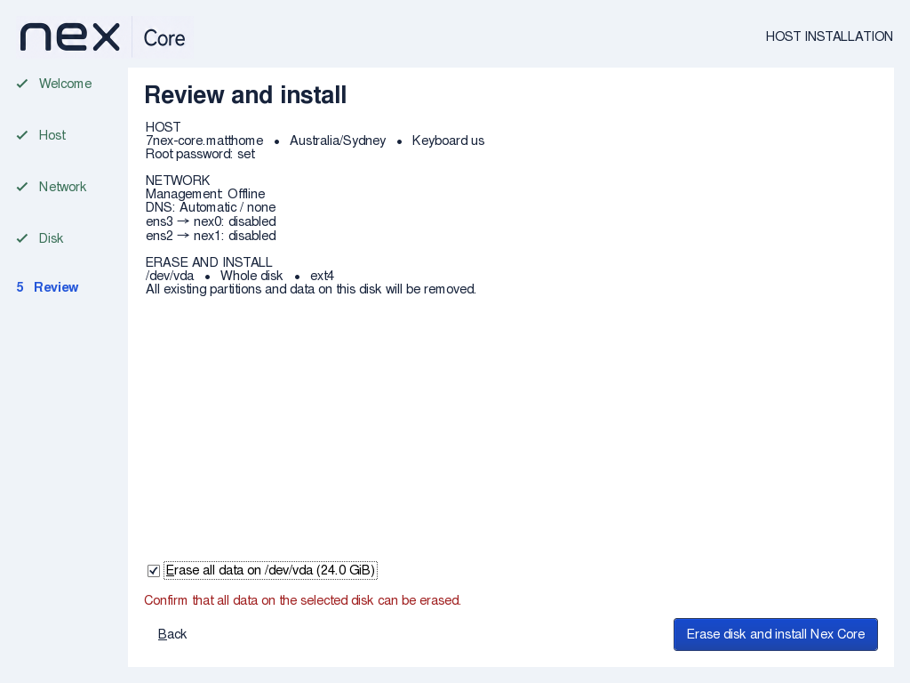

# Xen disk and network indicator verification

Nex Core 0.1.0-alpha1, 2026-09-08.

API impact: none; the local installer does not change Controller operations, agent commands,
observed-state results or client APIs. Guide impact: updated for Xen disk eligibility and
the green carrier indicator. Hostname hover explanations were removed; validation remains.

## Artifact and checks

ISO SHA256: `6975c894703b1e7fb29bc65bd2b02caba0d63fc5403e962e88dce6bd29636ae2`.
Build and checksum verification passed. Retained wizard/backend source comparisons and
complete-initrd artwork/script checks passed. Strict GTK and backend compilation passed.

`installer-disk.py` exercises the actual backend validator with simulated stat/sysfs/mount
boundaries. The original validator rejects valid `/dev/xvda`; the fixed version accepts
Xen, SCSI, virtio and NVMe names. Partitions, read-only/removable media, installation media,
missing/nonblock devices and changed capacity/device/serial identity are rejected.
`installer-link.py`, `installer-hostname.py`, `installer-handoff.py` and installer syntax/mode
checks passed. Both GitHub and Gitea installer workflows include the disk regression.

## Native walkthrough

The final ISO passed `wizard-review.py` at 1024×768 with two virtio NICs under QEMU/KVM,
4 GiB RAM and a fresh disposable 24 GiB raw disk. Actual virtual cable toggles showed
green Link detected → neutral No link → green Link detected without losing partial IP
input. Captures were inspected. Hostname inputs have no verbose hover tooltip in source;
qualified-name synchronization and invalid-input recovery passed in the native walkthrough.
Erase confirmation activation, reset and unchecked rejection passed without disk writes.
The test also passed fullscreen and timezone-dropdown checks, then stopped the VM.

Documentation structure and whitespace checks passed. Independent source, regression, documentation and native capture review
completed with no blocking findings.

## Limits

Xen device boundaries are simulated; an actual Xen installation and completed install/reboot
remain unverified for this slice. Native GUI testing uses QEMU virtio devices and a disposable
raw-file disk. No production disks or live infrastructure are touched. Hosted CI and clean
commit-range coverage are not claimed.
