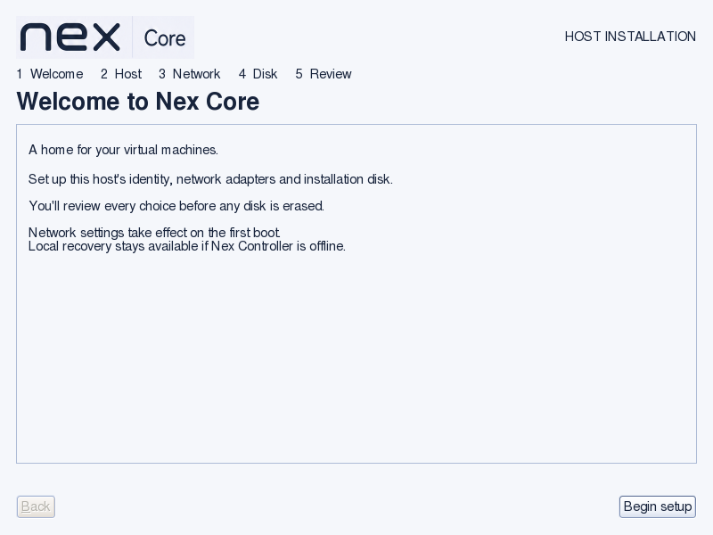
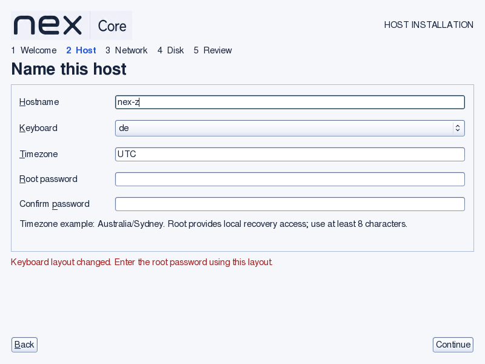
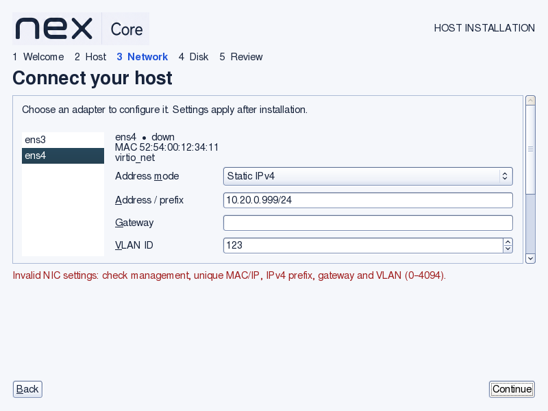
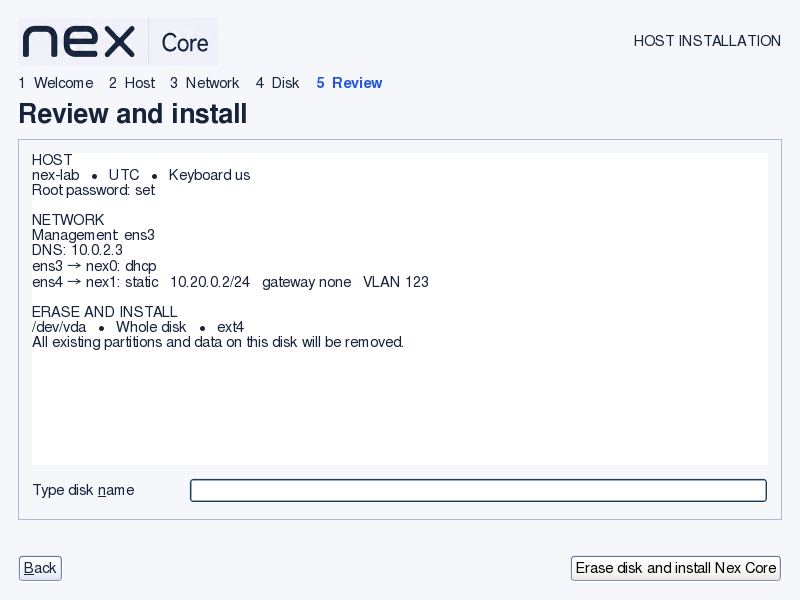
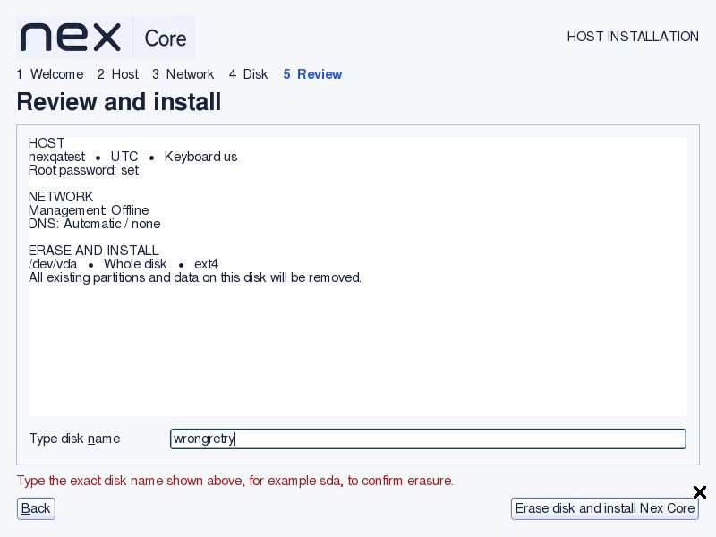

# Nex Core custom wizard verification

Date: 2026-09-08. Version: Nex Core 0.1.0-alpha1 amd64.

## Artifacts and scope

Final ISO SHA256: `00ab44d13f9977737dbad50ffb684e94019dded93007ccc1da2561d464d2d532`.
Full installation and installed-host checks used the preceding build,
`03982470c044fb1babceb77ce452fa0696eb33f23d1047a84c1a924ac57e5836`.
The final change keeps the confirmation field visible after an error. SHA256 comparison
confirmed identical `nex-config` binary, network model, preparation/start/recheck scripts
and late-install script. Final native GUI regression was rerun against the final ISO.

This replaces the earlier cdebconf-only presentation with a standalone Nex setup wizard.
Debian remains the installation engine, including failure dialogs. GUI defaults are loaded
from the initrd before the wizard; the normal path no longer enters file-preseed's
“Load debconf preconfiguration file” screen. This does not promise a flicker-free firmware,
video-mode transition or suppress real installation errors.

## Native walkthrough

Used QEMU/KVM, 2 CPUs, 4 GiB RAM, 800×600 VGA, a newly created 24 GiB raw-file disk
(serial `NEX-WIZARD-LAB`), and two virtio NICs with MACs ending `34:10` and `34:11`.
Booted the actual BIOS ISO menu. QMP keyboard/mouse input exercised the native GTK UI;
these are framebuffer captures, not browser mockups.

- Hardware preparation completed and both NICs were listed with name, MAC, driver and state.
- Selected German keyboard: physical Y produced Z; existing password fields were cleared.
  Returned to US and entered disposable test credentials. Keyboard capture is from the
  preceding development build; the final callback and initialization checks also pass.
- Configured management ens3 with DHCP and explicit DNS `10.0.2.3`; configured ens4 with
  `10.20.0.2/24`, VLAN 123, no gateway. Switching adapters retained each configuration.
- Invalid IPv4 `10.20.0.999/24` was rejected and could be corrected.
- Continuing without a disk selection was rejected. Explicitly selected `/dev/vda`.
- Reviewed all settings and installed names ens3 → nex0, ens4 → nex1. A wrong typed disk
  name was rejected without writing the disk. Explicitly typed `vda` and selected erase/install.
- The normal installation then ran through Debian's engine and rebooted. Booted the disk
  with the ISO detached; local root login succeeded with the entered password.

## Installed result

Observed the expected `nex-lab` hostname and Nex Core identity. `libvirtd`, `ssh`, `chrony`
and `networking` were active at first observation; the later acceptance check verified
`libvirtd.socket` because the idle libvirt service can stop between requests. nex0 acquired `10.0.2.15/24` by DHCP with the only IPv4
default route through `10.0.2.2`. nex1.123 was up with `10.20.0.2/24`; `ip -d link`
reported 802.1Q VLAN 123. The explicit DNS override remained `10.0.2.3`.

The read-only `tests/integration/wizard-installed.sh` passed: each service/socket check,
IPv4 addresses, VLAN ID, default route, DNS readable by nobody, public file permissions,
and absence of the disposable password in existing installer logs. Management ping
received two replies. Captured Ethernet frames on the second NIC carried VLAN 123;
the tagged peer ping failed as expected because this QEMU network has no tagged peer.
This establishes tagging, not switch connectivity. [Actual output](wizard/installed-check.txt). Installation-time transient credential/log checks
could not finish before automatic reboot; installed-log checks must not be presented
as inspection of the vanished initramfs. Source review and simulated handoff tests cover
private file handling and suppressed preseed input logging.

## Regression and review evidence

- `installer/check.sh`: boot modes and safe minimal policy pass.
- `installer-shell.py`: actual compiled classifier passes.
- `installer-network.c`: strict C compile and checks pass, including invalid NIC settings,
  VLAN output, MAC binding, management/secondary DHCP policy, DNS override and permissions
  under umask 0077. Secondary DHCP policy has unit output coverage, not a second runtime lease test.
- `installer-handoff.py`: simulated native seed import preserves earlier logs without retaining
  the hash; the partman hook propagates failure; caller umask is restored.
- `installer-keyboard.py`: actual callback compiled with a simulated process/GTK boundary;
  selected layout, clearing credentials, command failure and initialization checks pass.
- `installer-logo.py`: complete concatenated initrd retains approved artwork and parent paths,
  and rejects overlay directories that would replace base symlinks.
- `wizard-review.py`: actual final-ISO kernel/initrd with a test-only preparation marker;
  no NIC and a fresh 24 GiB disk. Preparation rejects leaked raw PROGRESS protocol;
  a negative control verifies the guard blocks its success marker. Visible review content, wrong confirmation, recovery field
  visibility and unchanged first 1 MiB of the disk pass at 800×600. The previous broken
  error-layout capture fails the new visibility assertion (zero dark text pixels).
  This image-region check guards those specific regressions, not every visual defect.

Both GitHub and Gitea installer workflows now execute the focused checks, build the ISO,
and run the native GUI regression on pushes and pull requests. Docker/QEMU prerequisites
fail explicitly. Hosted CI was not run or claimed; this work is unpushed.
Documentation structure (`check_docs.py --all`), all 13 checker unit tests and
`git diff --check` passed. Clean-commit range coverage and hosted CI remain unexecuted.
Independent reviews found and verified corrections for keyboard state, private umask,
preseed failure handling, initrd paths, network permissions, and review/error rendering.

## Limits and impact

No physical hardware, UEFI installation, Secure Boot, switch VLAN connectivity, IPv6 editor,
bonding, bridges, trunks, multiple VLANs per NIC or manual GUI partitioning was verified.
The GUI controls IPv4; observed Debian IPv6 autoconfiguration remains enabled, including
on a VLAN's untagged parent. IPv4 default-route ownership is not IPv6 isolation.
Disk identity uses device number, capacity and available serial; a device without a serial
has weaker protection against same-size hot replacement. Do not hot-swap installation disks.
Minimal text/serial paths retain the existing installer behavior. Whole-ISO source and
artwork redistribution gates remain open in [licensing](../../LICENSING.md).

API impact: none. Local wizard → protected configuration → Debian installer → target files
introduces no Controller operation, Core agent command/result or client-facing API.
Guide impact: updated for actual GUI steps, network persistence, confirmation and recovery.
