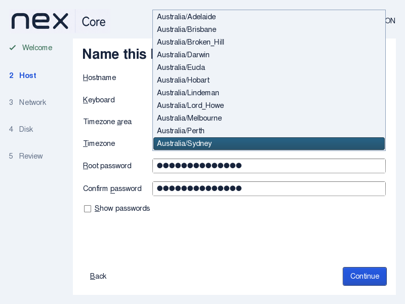
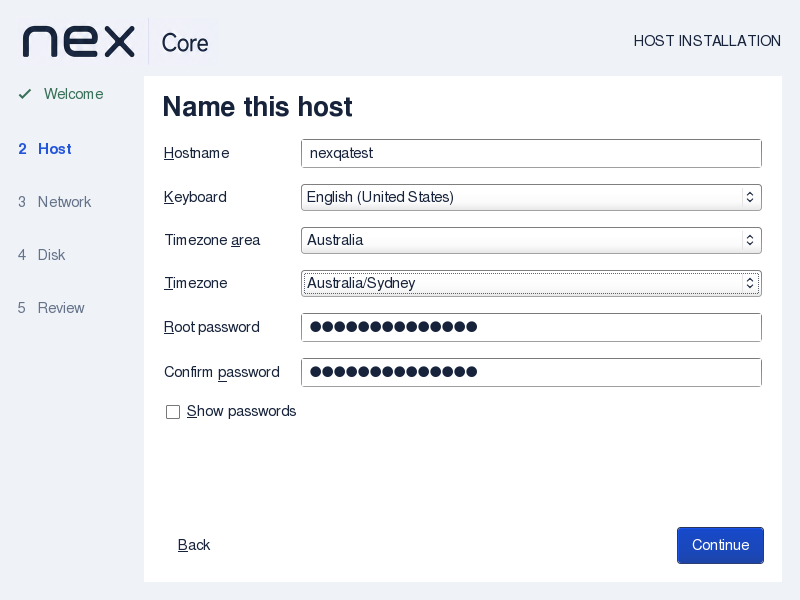
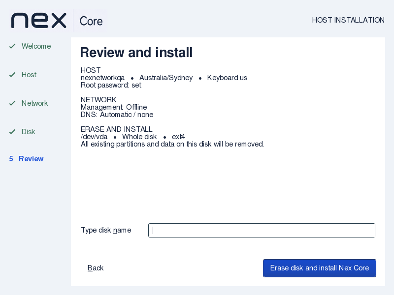

# Timezone dropdown verification

Nex Core 0.1.0-alpha1, 2026-09-08.

Replaces timezone text entry with area and timezone dropdowns; removes Test keyboard.
UTC is the default. Both controls use the bundled supported identifiers and keep the
existing protected installer configuration and backend validation.

API impact: none; no Controller/Core or client-facing contract changes.
Guide impact: updated. This replaces the searchable text entry and keyboard-test
controls described in the preceding QoL report; those captures remain historical.

## Artifact and checks

ISO SHA256: `f0387810a37eadd6b2340041423debf76bffff783b645ed776a540126bf167bd`.
Checksum, complete-initrd checks and retained wizard-source comparison passed.

Native QEMU/KVM walkthroughs passed at 800×600 with no NICs and 1024×768 with two
virtio NICs, 4 GiB RAM and disposable 24 GiB raw-file disks. Both used the actual ISO
kernel/initrd with the existing test-only preparation marker. Only arrows and dropdown
selection chose Australia, then Australia/Sydney; the final review shows that canonical
value. No timezone text was typed. Inspected captures confirm Test keyboard is absent.
The retained password visibility/reset, shared hostname and disk-rejection checks passed;
wrong confirmation left the first 1 MiB of the disposable disk untouched. VMs were stopped.

Strict compilation, `installer-qol.py`, `installer-keyboard.py`, `installer/check.sh`,
`check_docs.py --all` and `git diff --check` passed. The focused QoL check failed the
previous source and checks noneditable controls plus region-switch clearing/selection.
Both existing GitHub and Gitea workflows run these regressions and the native tests;
no hosted run or clean-commit documentation-range check is claimed.

No full installation or physical/UEFI walkthrough was repeated for this widget-only
change. Existing backend validation remains in place. Independent source review found
no material issue; native visual review is recorded with this change.
