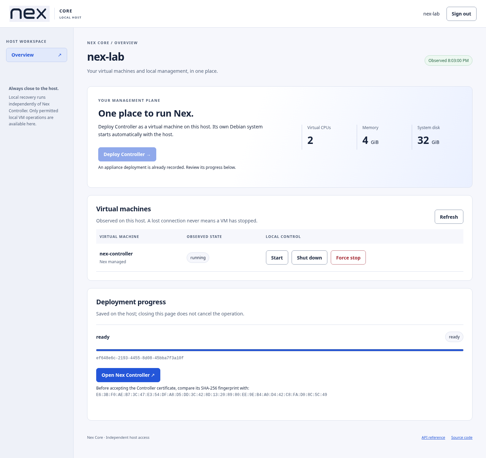
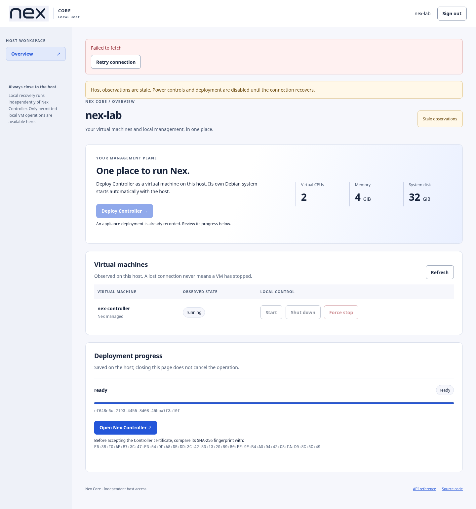
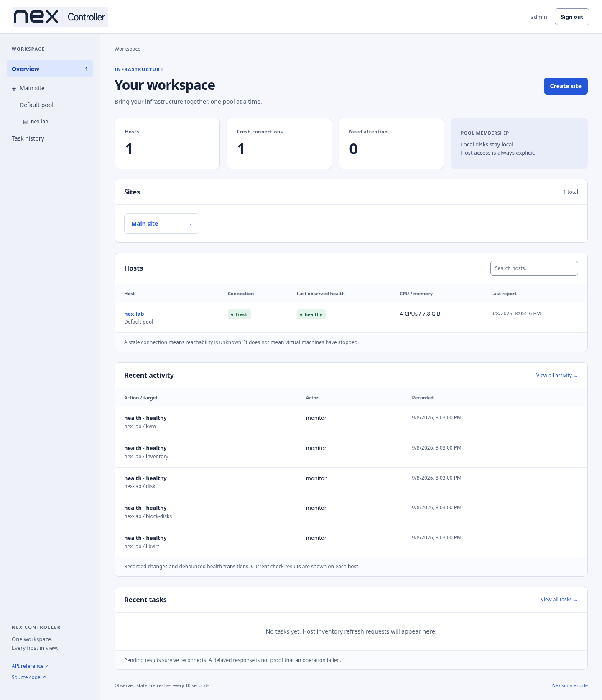

# Security package: real disposable appliance verification

Date: 2026-09-08. Clean deployment, security/outage checks, host autostart and post-reboot browser verification passed. Disposable VMs are shut down.

## Environment and artifact

A new private copy of the earlier disposable Core wizard disk ran Debian 13 in QEMU
11.1.1/KVM with four vCPUs and 8 GiB RAM. A newly created, explicitly checked 80 GiB
regular-file disk supplied local ext4 storage. The nested appliance used the guest's
existing isolated `virbr0` NAT bridge and static `192.168.122.10/24`. Workstation disks,
network settings and unrelated services were not changed. Earlier appliance QA and
private recovery archives remain preserved and were not reused.

After refreshing the copied guest's apt indexes, `apt-get install /root/security.deb`
installed the package and its declared dependencies. The shipped setup command selected
management address `10.0.2.15`, storage `/var/lib/nex/appliances` and bridge `virbr0`.
Native systemd service retained `UMask=0077`. Browser access used loopback QEMU/SSH
forwards; certificate fingerprints were compared explicitly after reboot.

| Artifact | SHA-256 |
| --- | --- |
| `nex-core-local_0.1.0+security1_amd64.deb` | `06485e63ee2b05260601062c6307e5d48c167605d6a56bae1bb438f912dae785` |
| Installed local executable | `a0fc17060c66412cbeac642402d83cc203cbf14839dae1a04b2d2a8534c04539` |
| Signed security1 appliance | `ae9890a20ff84e112441c30abc0a4a1dedfe4f3898208a8c1619bee9ed66202f` |
| Running guest Controller executable | `93a5a381edb9636760f1b37c1fafe361829e6145cc3df6c73dfb4f5e06ff1ff9` |
| Guest matching Nex source | `958723923c1e144e517229693a7224f2524030fe79830b761bcb79e6c8aba451` |

[Installed artifact output](lab/installed-artifacts.txt), [guest hashes](lab/guest-artifacts.txt).
The [package checks](package.md) record the Go 1.27.1 build and exact-binary verification.

## Executed flow and results

```sh
.cache/phase1-qa-venv/bin/python tests/integration/appliance-lab.py \
  --lab-dir .cache/nex-appliance-lab.2851um6a \
  --evidence docs/qa/security/lab --deploy --packaged --security
```

This completed against actual HTTPS services and libvirt/QEMU execution, with no HTTP
mocks or guest patches. A private administrator password containing exactly 16 Unicode
code points (including non-ASCII characters) successfully passed the GUI, API, NoCloud
initialization and actual Controller login.

- Authentication, anonymous inventory rejection, CSRF enforcement, invalid deployment
  input and modified signed-manifest rejection passed before VM creation.
- The browser's reviewed deployment progressed through 0, 10, 92, 98 and verified 100.
  Exactly one VM UUID `91291c3e-b2c9-454a-8f77-4eaeb8bf392e`, one Site, one Pool, one
  enrolled host and one adopted Controller VM were observed.
- Both services set `__Host-` cookies with Secure, HttpOnly, SameSite=Strict and root
  path. Browser headers included no-store, nosniff, no-referrer, frame denial and CSP
  without unsafe-inline/unsafe-eval. GUI rendering and interactions worked under it.
- Six invalid login requests per service produced rate limiting despite changing
  `X-Forwarded-For` on every request: Controller returned five 401 responses then 429;
  local returned four 401 responses then 429 twice, following its successful login.
  This establishes the real peer-based five-attempt gate; no claim is made that proxy
  headers identify independent clients. Cookie values/passwords were not recorded.
- Bootstrap configuration, password and persistent/runtime cloud-init private caches
  were absent before reboot. Controller outage retained a running VM and local access.
- Wrong typed shutdown confirmation was rejected. Graceful shutdown/cold start retained
  static networking and initialized Controller identity without a seed disk.
- Stopping local management showed stale observations and disabled power controls while
  Controller HTTPS remained available. Restart after agent/libvirt child activity
  acquired the service lock and retained one running VM and one deployment operation.
- Desktop and 390-pixel layouts were inspected; no horizontal overflow or uncaught
  browser errors were found. Actual loading, empty, invalid-login and outage states
  were captured.

[Actual results](lab/results.json), [headers/cookie attributes/rate-limit responses](lab/security.json),
[deployment progress](lab/deployment.json), [Controller inventory](lab/controller-inventory.json),
[guest cold-start output](lab/controller-cold-start.txt).




## Host reboot and cleanup

An actual outer-host reboot changed the boot ID and automatically started both native
local management and the same appliance UUID, with libvirt autostart enabled
([labeled output](lab/host-reboot.txt)). Browser sign-in again accepted the original
Unicode password; original Site/Pool/host/VM identities, the exact deployment TLS pin
and matching `/source` archive were retained. The enrolled agent reported fresh and
the VM running. [Post-reboot assertions](lab/host-reboot-results.json),
[observed inventory](lab/host-reboot-inventory.json).



The appliance was shut down gracefully, then the outer host powered off. Its QEMU
process exited, with the copied disk preserved ([cleanup evidence](lab/shutdown.json)).
No test VM was left running. The earlier four appliance labs remained stopped.

## Limits

This is a disposable nested-KVM test with isolated NAT, not physical hardware or
production-LAN verification. The previous same-version separate-host recovery walkthrough
used appliance 6/package 6.1; recovery was not repeated using security1, and no cross-version
archive restore was attempted. The new idle-session database migration and simulated
clock-expiry paths are covered by the separate focused Go/browser checks, not an elapsed
30-minute idle wait in this lab. Whole-distribution release clearance and hosted CI remain
separate evidence gates.
